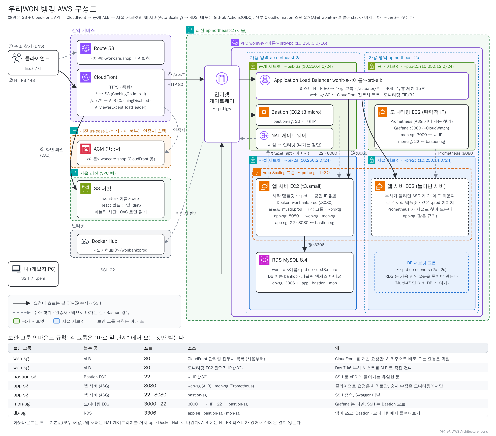
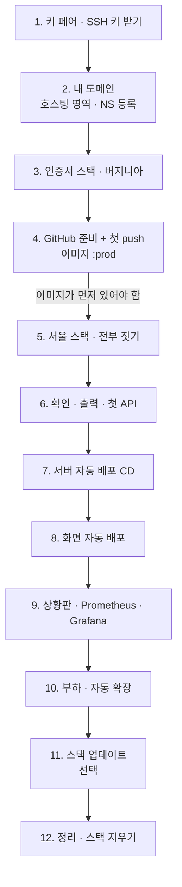
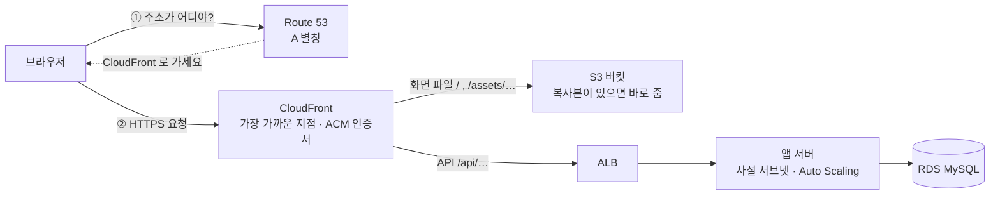
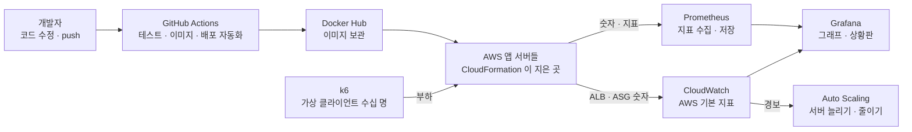
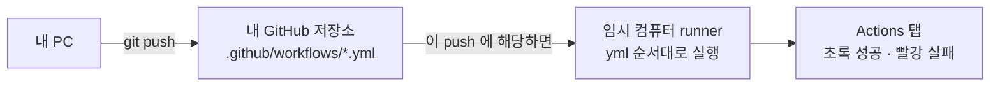
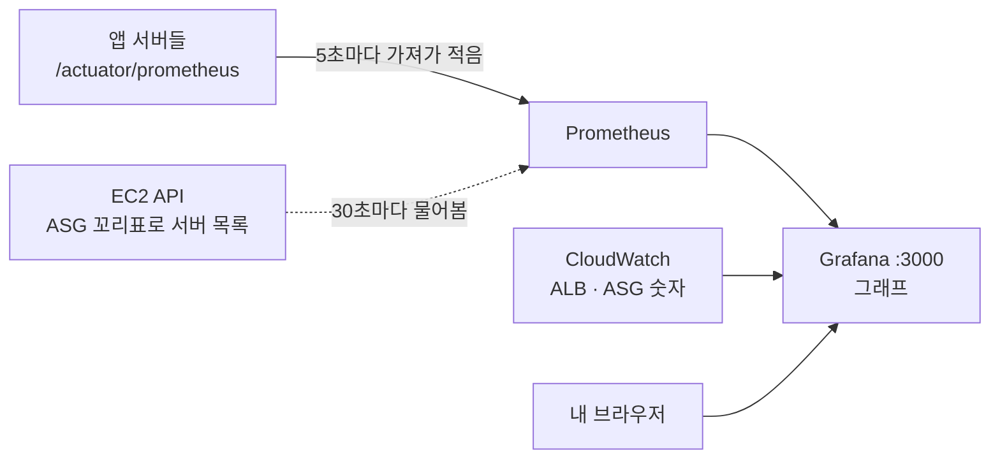

# AWS 배포 한 번에: CloudFormation 으로 우리WON 뱅킹 짓기

> 이 자료 하나만 따라가면 됩니다. 템플릿 파일 두 개(`infra/wonit-a-cert.yaml`, `infra/wonit-a-aws.yaml`)가 AWS 자원을 **전부** 만들고, 우리는 GitHub Actions 로 서버 · 화면을 자동 배포하고, Prometheus · Grafana 로 상황판을 보고, 부하를 걸어 서버가 저절로 늘어나는 것까지 봅니다.



---

## 0. 한눈에 보기

### 무엇을 만드나요?

| 하는 일 | 누가 | 어떻게 만드나 |
|---|---|---|
| 주소 `https://<이름>.woncare.shop` 과 자물쇠(HTTPS) | Route 53 · ACM 인증서 | 호스팅 영역은 직접 1번, 인증서는 **인증서 스택** |
| 화면(React) 파일 보관과 배달 | S3 · CloudFront | **서울 스택** |
| API(`/api/…`) 받아서 서버에 나눠 주기 | ALB(로드 밸런서) | **서울 스택** |
| 서버(Spring Boot) 여러 대, 쓰러지면 새로, 바쁘면 더 | EC2 · Auto Scaling 그룹 | **서울 스택** |
| 데이터베이스 | RDS MySQL | **서울 스택** |
| 상황판 | 모니터링 EC2 의 Prometheus · Grafana | **서울 스택** (켜지면서 저절로 뜸) |
| push 하면 테스트 → 이미지 → 서버 교체, 화면 업로드 | GitHub Actions | `ci/backend.yml` · `ci/frontend.yml` 을 내 저장소에 놓기 |

### 준비물

- [ ] AWS 계정(수업 때 받은 IAM 사용자), **리전 서울**
- [ ] GitHub 계정, Docker Hub 계정
- [ ] 내 PC: Git Bash(Windows) 또는 터미널, 브라우저
- [ ] 내 이름(영문 소문자 2~16자). 이 자료의 `<이름>` 자리에 넣습니다. 예: `kimyeonji`

### 순서 (이 순서가 중요합니다)



> 💡 **왜 4번이 5번보다 먼저인가요?** 서버는 켜질 때 Docker Hub 의 `<도커허브ID>/wonbank:prod` 이미지를 받아 실행합니다. 이미지가 없으면 서버가 계속 실패하고, Auto Scaling 이 서버를 끝없이 갈아 끼웁니다.

### 💰 요금

스택이 서 있는 동안 1명 **시간당 약 0.25달러(약 350원)** 입니다. NAT 게이트웨이 · ALB · EC2 3대(앱 서버 · 모니터링 t3.small, Bastion t3.micro) · RDS 가 대부분이고, S3 · CloudFront 는 수업 사용량이면 거의 0원입니다. **수업이 끝나면 12번대로 꼭 지웁니다.**

---

## 1. 먼저 알기: 큰 그림

### 클라이언트가 사이트를 열면



### 은행 지점으로 비유하면

| AWS | 하는 일 | 은행 비유 |
|---|---|---|
| **VPC** | 내 전용 네트워크 | 은행 건물 |
| **공개 서브넷 / 사설 서브넷** | 인터넷에서 닿는 곳 / 안 닿는 곳 | 길가 층 / 안쪽 층 |
| **NAT 게이트웨이** | 사설 서브넷 서버가 밖으로 나갈 때만 쓰는 문 (들어오는 것은 막음) | 직원용 우편 창구 |
| **Bastion** | 관리자가 SSH 로 안쪽에 들어가는 유일한 문 | 직원 전용 쪽문 |
| **보안 그룹** | 서버마다 "누가 몇 번 문으로 들어올 수 있나" 명부 | 출입 명부 |
| **ALB** | 요청을 받아 쉬고 있는 서버로 나눠 줌, 아픈 서버는 뺌 | 번호표 안내원 |
| **Auto Scaling 그룹** | 서버를 몇 대 둘지 관리. 쓰러지면 새로, 바쁘면 더 | 인사팀 |
| **시작 템플릿** | 새 서버를 켤 때 할 일 (Docker 설치 → 앱 실행) | 신입 직원 업무 매뉴얼 |
| **RDS** | 관리형 MySQL | 지하 금고실 |
| **S3 · CloudFront** | 화면 파일 창고 · 전 세계 배달망 | 서류 창고 · 안내 데스크 |
| **Route 53 · ACM** | 주소록 · HTTPS 인증서 | 간판 주소 · 사업자 등록증 |
| **Prometheus · Grafana** | 서버 숫자를 모아 적기 · 그래프로 보기 | 기록원 · 상황판 |
| **GitHub Actions** | push 하면 정해 둔 작업을 대신 실행 | 자동 업무 처리반 |
| **OIDC 배포 역할** | GitHub 가 비밀번호 없이 AWS 에 잠깐 들어오는 출입증 | 일회용 방문증 |

### 보안 그룹: "바로 앞 단계에서 온 것만 받는다"

수업에서는 Bastion SSH(22) 와 Grafana(3000) 만 인터넷 전체(`0.0.0.0/0`)에 엽니다 (`MyIpCidr` 기본값). 나머지 문은 모두 바로 앞 단계에서 온 것만 받습니다.

> 💡 실무라면 `MyIpCidr` 를 `<내 IP>/32` 로 좁혀 이 두 문도 내 PC 에게만 엽니다.

| 보안 그룹 | 붙는 곳 | 들어올 수 있는 것 |
|---|---|---|
| `…-prd-web-sg` | ALB | 80 ← **CloudFront** 만 (+ 모니터링 EC2, 부하 테스트용) |
| `…-prd-bastion-sg` | Bastion | 22 ← `MyIpCidr` (기본 `0.0.0.0/0`) |
| `…-prd-app-sg` | 앱 서버 | 8080 ← ALB · 모니터링, 22 · 8080 ← Bastion |
| `…-prd-mon-sg` | 모니터링 EC2 | 3000(Grafana) ← `MyIpCidr` (기본 `0.0.0.0/0`), 22 ← Bastion |
| `…-prd-db-sg` | RDS | 3306 ← 앱 서버 · Bastion · 모니터링 |

---

## 2. 먼저 알기: CloudFormation

**한 줄로**: 만들 자원을 **YAML 파일(템플릿)** 에 적어 두면, AWS 가 그대로 **한 번에(스택)** 지어 줍니다. 콘솔에서 수십 번 클릭할 일을 파일 하나로 합니다.

**왜 쓰나요?** 콘솔에서 VPC · 서브넷 · 보안 그룹 · ALB · Auto Scaling · RDS · CloudFront 를 하나씩 클릭해 만들면 수십 단계를 거치고, 칸 하나만 잘못 골라도 어디가 틀렸는지 찾기 어렵습니다. 템플릿은

- **똑같이 다시 지을 수 있습니다.** 25명이 같은 파일로 같은 구성을 만들고, 지웠다가 다시 지어도 같습니다.
- **한 번에 지웁니다.** 스택을 지우면 스택이 만든 것이 모두 지워져 요금이 새는 자원이 남지 않습니다.
- **읽을 수 있는 기록이 됩니다.** "무엇을 어떻게 만들었나" 가 파일로 남아 코드처럼 리뷰하고 Git 으로 관리합니다 (이것을 IaC, Infrastructure as Code 라고 합니다).

| 말 | 뜻 | 비유 |
|---|---|---|
| **템플릿** | 무엇을 만들지 적은 YAML 파일 | 건물 설계도 |
| **스택** | 템플릿으로 실제로 지은 자원 묶음 | 설계도로 지은 건물 한 채 |
| **파라미터** | 만들 때 채우는 빈칸 (이름, 도메인 등) | 설계도의 빈칸 |
| **출력** | 다 지은 뒤 알려 주는 값 (주소, 이름 등) | 준공 후 받는 열쇠 꾸러미 |
| **스택 업데이트** | 값만 바꿔 다시 적용 | 리모델링 |
| **스택 삭제** | 스택이 만든 것을 **전부** 지움 | 철거 |

> 💡 콘솔에 보이는 글자(설명 · 출력)는 한글이 깨지지 않게 영어로 적혀 있고, 한글 설명은 파일 안의 `#` 주석에 있습니다.

### 쓰는 파일

| 파일 | 어디서 | 하는 일 |
|---|---|---|
| `infra/wonit-a-cert.yaml` | **버지니아(us-east-1)** 스택 `wonit-a-<이름>-cert` | 내 도메인의 HTTPS 인증서. 검증 레코드까지 저절로 넣음 |
| `infra/wonit-a-aws.yaml` | **서울** 스택 `wonit-a-<이름>-stack` | 나머지 **전부** (아래 표) |
| `ci/backend.yml` | GitHub Actions | push → 테스트 → 이미지 → `:prod` → 서버 교체 |
| `ci/frontend.yml` | GitHub Actions | push → 화면 빌드 → S3 업로드 → CloudFront 무효화 |
| `load/transfers.js` | 모니터링 EC2 | k6 부하 테스트 (가입 · 입금 · 이체 반복) |

### `wonit-a-aws.yaml` 안의 구역 (주석 `# 01.` `# 05.` … 번호)

| 구역 | 만드는 것 |
|---|---|
| 01 네트워크 | VPC · 서브넷 4개(공개 2a/2c, 사설 2a/2c) · 인터넷 게이트웨이 · **NAT 게이트웨이** · 라우팅 |
| 05 보안 그룹 | 위 표의 5개 |
| 03 RDS | MySQL 8.4 (`bankdb`), 사설 서브넷, 퍼블릭 액세스 아니요 |
| 04 시작 템플릿 | 앱 서버가 켜질 때: Docker 설치 → `.env`(DB · JWT · Gemini) → `<도커허브ID>/wonbank:prod` 실행 |
| 05 ALB | 대상 그룹(상태 검사 `/actuator/health`) · 리스너 80 · `/actuator/*` 는 밖에서 403 · 유휴 제한 15초 |
| 06 Auto Scaling | 서버 1~3대(`MinServers` · `MaxServers` 로 바꿈), 사설 서브넷 2곳, 상태 검사 유예 300초, 교체 때 새 서버 먼저(100/200), **요청 수 기준 자동 확장 정책** |
| 07 모니터링 | 모니터링 EC2(공개 2c) + 탄력적 IP + 역할. 켜지면서 **Prometheus · Grafana** 컨테이너를 띄움. **Bastion**(t3.micro) |
| 08 배포 역할 | GitHub Actions 용 **OIDC 역할**: 내 저장소 `main` 만 사용 가능, 할 수 있는 일은 서버 교체 · S3 업로드 · 무효화뿐 |
| 09 화면 | S3 버킷(잠금) · OAC · CloudFront(동작 2개) · Route 53 A 별칭 |

## 3. 먼저 알기: 도구마다 하는 일과 쓰는 이유

AWS 위에 서버를 띄우는 것만으로는 끝이 아닙니다. **코드를 고칠 때마다 다시 올려야 하고(배포)**, **서버가 지금 괜찮은지 봐야 하고(모니터링)**, **사람이 몰려도 버티는지 미리 확인해야(부하 테스트)** 합니다. 이 세 가지를 도와주는 도구가 GitHub Actions · Prometheus · Grafana · k6 입니다.



### GitHub Actions: 배포를 사람 대신 해 주는 자동 처리반

| | |
|---|---|
| **무엇** | GitHub 저장소에 적어 둔 작업 순서(`.github/workflows/*.yml`)를 push 할 때마다 GitHub 의 임시 컴퓨터가 대신 실행하는 **CI/CD 도구** |
| **없으면** | 코드를 고칠 때마다 손으로 테스트 → 이미지 빌드 → Docker Hub 업로드 → 서버 교체를 해야 합니다. 테스트를 깜빡하고 올리거나, 내 PC(Mac arm64)에서 만든 이미지가 서버(amd64)에서 안 도는 일이 생깁니다. 사람마다 순서와 결과가 달라집니다 |
| **그래서** | 순서를 파일로 정해 두고 **push 하면 언제나 같은 환경 · 같은 순서**로 돌게 합니다. 테스트가 깨지면 배포까지 가지 않고 멈춥니다(빨간 X) |
| **우리는** | `backend.yml`: 테스트 → 이미지 → `:prod` 이름표 → 서버 교체 · `frontend.yml`: 화면 빌드 → S3 → CloudFront 무효화 |
| **말** | **CI**(계속 합치기) = 올릴 때마다 자동으로 테스트하고 이미지까지 만들어 두기 · **CD**(계속 내보내기) = 그 이미지를 서버에 자동으로 가져다 놓기 |
| **실무에서는** | Jenkins, GitLab CI, AWS CodePipeline 도 같은 일을 합니다 |

### Prometheus: 서버 숫자를 모아 적는 기록원

| | |
|---|---|
| **무엇** | 정해진 시간마다 서버를 **찾아가서** 숫자(지표)를 받아 와 시간 순서대로 적어 두는 **지표 수집 · 저장 도구** |
| **없으면** | 로그는 "무슨 일이 있었나" 는 알려 주지만 "지금 초당 몇 건 오나, 응답이 몇 초 걸리나, DB 연결이 모자라나" 는 바로 안 보입니다. 게다가 서버는 사설 서브넷에 여러 대이고 Auto Scaling 이 늘리고 줄여서, 서버마다 들어가 볼 수도 없습니다 |
| **그래서** | 서버가 `/actuator/prometheus` 에 숫자를 내놓고, Prometheus 가 **5초마다 모든 서버를 돌며** 가져가 적습니다. 서버 목록은 EC2 에 "꼬리표가 내 ASG 인 서버" 를 물어 알아내므로 서버가 늘어도 설정을 고치지 않습니다 |
| **우리는** | 모니터링 EC2 에서 컨테이너로 돕니다 (스택이 켜 둠). 직접 화면을 볼 일은 거의 없고, Grafana 가 이 장부를 읽어 그립니다 |
| **실무에서는** | Datadog, New Relic, CloudWatch Agent 같은 유료 · 관리형 서비스도 같은 역할입니다 |

### Grafana: 숫자를 그래프로 보여 주는 상황판

| | |
|---|---|
| **무엇** | Prometheus · CloudWatch 같은 여러 곳의 숫자를 **그래프 · 대시보드**로 보여 주고, 기준을 넘으면 **알림**을 보내는 도구 |
| **없으면** | Prometheus 의 숫자는 `http_server_requests_seconds_count{…} 2031.0` 같은 글이라 사람이 흐름을 읽기 어렵습니다. 서버 안쪽 숫자(Prometheus)와 AWS 바깥 숫자(CloudWatch)도 따로따로 봐야 합니다 |
| **그래서** | 한 화면에 "초당 이체 건수 · 응답 시간 · DB 연결 · 서버 수 · ALB 요청 수" 를 같이 놓고 **변화를 눈으로** 봅니다. 부하를 걸 때 어디가 먼저 버거워지는지(병목)를 찾는 판입니다 |
| **우리는** | 데이터 소스 2개(Prometheus · CloudWatch) 연결 → 만들어진 대시보드 19004 불러오기 → 내 패널 2개 |

> 💡 **CloudWatch 는 뭐가 다른가요?** AWS 가 ALB · EC2 · Auto Scaling 을 재서 **저절로** 적어 두는 숫자입니다(설치 없음). 서버 **바깥**에서 본 숫자(ALB 요청 수 · 정상 서버 수)이고, Auto Scaling 의 자동 확장 **경보**도 이 숫자를 봅니다. Prometheus 는 앱 **안쪽** 숫자(이체 건수 · DB 연결 · JVM 메모리)를 봅니다. 둘을 Grafana 한 화면에 놓습니다.

### k6: 가짜 클라이언트를 많이 보내는 부하 테스트 도구

| | |
|---|---|
| **무엇** | 스크립트(JavaScript)에 적은 대로 **가상 클라이언트 수십~수천 명**이 동시에 요청을 보내고, 응답 시간 · 실패율을 재 주는 **부하 테스트 도구** |
| **없으면** | 실제 클라이언트가 몰린 날에야 "서버가 몇 명까지 버티는지", "자동 확장이 정말 되는지", "어디서 느려지는지" 를 알게 됩니다. 은행 서비스라면 그날은 이미 사고입니다 |
| **그래서** | 미리 일부러 몰려 보고 **숫자로 확인**합니다: 10명일 때와 50명일 때 응답 시간이 얼마나 늘었나, 실패가 생기나, 서버가 몇 분 만에 늘어나나, 늘어난 뒤 다시 빨라지나 |
| **우리는** | `load/transfers.js`: 회원 2명을 만들고 입금한 뒤 "계좌 보기 → 10원 이체" 를 반복합니다. 설치 없이 모니터링 EC2 에서 Docker(`grafana/k6`)로 돌리고, ALB 주소로 직접 겁니다 |
| **읽을 숫자** | `http_req_duration`(응답 시간, 특히 p95 = 100건 중 느린 쪽 5건 경계) · `http_req_failed`(실패율) · `http_reqs`(초당 요청 수) |
| **실무에서는** | JMeter, Locust, nGrinder 도 같은 일을 합니다 |

> 🚨 부하 테스트는 **내 서버에만** 겁니다. 남의 사이트에 걸면 공격입니다. 그리고 `/api/ai/*` 처럼 외부 유료 API 를 부르는 주소는 넣지 않습니다.

### 한 표로 정리

| 도구 | 한 줄 | 언제 쓰나 (이 자료에서) |
|---|---|---|
| CloudFormation | 인프라를 파일 하나로 짓고 지운다 | 3 · 5단계, 11 · 12단계 |
| GitHub Actions | push 하면 테스트 · 이미지 · 배포를 대신 한다 | 4 · 7 · 8단계 |
| Docker Hub | 서버가 받아 갈 이미지를 보관한다 | 4단계 |
| Prometheus | 서버 안쪽 숫자를 모아 적는다 | 9단계 |
| CloudWatch | AWS 가 재 주는 바깥 숫자 · 경보 | 9 · 10단계 |
| Grafana | 숫자를 그래프로 한 화면에 | 9 · 10단계 |
| k6 | 가짜 클라이언트로 미리 몰려 본다 | 10단계 |

---

## 4. 따라 하기

### 1단계. 키 페어 (SSH 키 받기)

> 💡 서버에 SSH 로 들어갈 때 쓰는 **열쇠 파일(`.pem`)** 을 AWS 에서 받습니다. 이 열쇠 하나로 Bastion · 앱 서버 · 모니터링 서버에 모두 들어갑니다. 파일은 **만들 때 한 번만** 내려받을 수 있습니다.

1. 콘솔 오른쪽 위 리전이 **아시아 태평양(서울)** 인지 보고 **EC2 → 키 페어 → 키 페어 생성**

   | 칸 | 값 |
   |---|---|
   | 이름 | `wonit-a-<이름>-key` |
   | 키 페어 유형 | RSA |
   | 프라이빗 키 파일 형식 | `.pem` |

2. **키 페어 생성** → `wonit-a-<이름>-key.pem` 파일이 내려받아집니다.
3. **내 PC (Git Bash)** → 열쇠를 `~/.ssh` 에 두고 나만 읽게 합니다.
   ```bash
   mkdir -p ~/.ssh && mv ~/Downloads/wonit-a-<이름>-key.pem ~/.ssh/ && chmod 400 ~/.ssh/wonit-a-<이름>-key.pem
   ```

**✅ 되었으면**: **EC2 → 키 페어** 목록에 `wonit-a-<이름>-key` 가 있고, 내 PC 의 `~/.ssh/` 에 `.pem` 파일이 있습니다.

> ⚠️ `.pem` 파일은 다시 내려받을 수 없습니다. 잃어버리지 않게 보관하고, 깃에 올리지 않습니다.

### 2단계. 내 도메인

1. **Route 53 → 호스팅 영역 → 호스팅 영역 생성** → 도메인 이름 `<이름>.woncare.shop`, **퍼블릭 호스팅 영역** → 생성
2. 만든 영역의 **NS 레코드 4줄**(`ns-….awsdns-….org` 등)을 복사해, 수업 때 안내하는 **발급 사이트**에 하위 도메인 `<이름>` 과 함께 등록합니다.
3. 영역 상세의 **호스팅 영역 ID**(`Z` 로 시작)를 메모합니다.
4. **내 PC** → NS 4줄이 나오면 연결된 것입니다 (몇 분 걸릴 수 있음).
   ```bash
   nslookup -type=NS <이름>.woncare.shop
   ```

**✅ 되었으면**: `nslookup` 결과의 NS 4개가 Route 53 의 4개와 같고, `Z…` 를 메모했습니다.

### 3단계. 인증서 스택 — 버지니아

> 💡 **왜 버지니아?** CloudFront 는 전 세계에 하나인 서비스라서 **버지니아 북부(us-east-1)** 에 있는 인증서만 읽습니다. 나머지는 모두 서울입니다.

1. 맨 위 첨부(또는 `WONIT-A/07_cicd` 저장소의 `infra/`)에서 `wonit-a-cert.yaml` · `wonit-a-aws.yaml` 을 내려받아 둡니다. 저장소 전체는 4단계에서 fork 해서 받습니다.
2. **콘솔 오른쪽 위 리전 → 미국 동부(버지니아 북부) us-east-1**
3. **CloudFormation → 스택 → 스택 생성 → 기존 템플릿 선택** → **템플릿 파일 업로드** → `infra/wonit-a-cert.yaml` → 다음
4. 채우기:

   | 칸 | 값 |
   |---|---|
   | 스택 이름 | `wonit-a-<이름>-cert` |
   | `YourName` | `<이름>` |
   | `DomainName` | `<이름>.woncare.shop` |
   | `HostedZoneId` | 2단계의 `Z…` |

5. 다음 → 다음 → **전송** → 잠시 기다리면 **CREATE_COMPLETE**.
6. **출력** 탭의 `CertificateArn`(`arn:aws:acm:us-east-1:…`)을 메모합니다.
7. **리전을 서울로 되돌립니다.**

**⚠️ 틀리기 쉬운 곳**
- 오래 `CREATE_IN_PROGRESS` → 2단계 NS 등록이 아직입니다. `nslookup` 을 다시 봅니다.
- 서울에서 만들면 `OnlyVirginia` 규칙 오류로 멈춥니다.

### 4단계. GitHub 준비 + 첫 push

> 💡 **GitHub Actions 가 뭔가요?** 저장소의 `.github/workflows/` 폴더에 적어 둔 작업 순서(yml)를, push 할 때마다 GitHub 가 빌려주는 임시 컴퓨터에서 대신 실행해 주는 서비스입니다. 결과는 저장소의 **Actions** 탭에 초록(성공) · 빨강(실패)으로 남습니다.



1. **GitHub → `WONIT-A/07_cicd` → Fork → Create fork** (Actions 는 내 저장소에서 돌기 때문입니다). workflow 두 개(`.github/workflows/backend.yml` · `frontend.yml`)는 이미 들어 있습니다.
2. **내 fork → Actions 탭** → **I understand my workflows, go ahead and enable them** 버튼을 누릅니다 (fork 한 저장소는 workflow 가 꺼진 채로 시작합니다).
3. **Docker Hub → 오른쪽 위 프로필 → Account settings → 왼쪽 Personal access tokens → Generate new token** → 설명(예: `wonit-a-<이름>-github-actions`), 권한 **Repo Read & Write** → **Generate** → 토큰을 복사합니다 (창을 닫으면 다시 볼 수 없습니다).
4. **내 fork → Settings → Secrets and variables → Actions**

   | 종류 | Name | Value |
   |---|---|---|
   | Variables | `DOCKERHUB_USERNAME` | 내 Docker Hub 아이디 |
   | Secrets | `DOCKERHUB_TOKEN` | 3번 토큰 |

5. **내 PC (Git Bash)** → 내 fork 를 받고, `src/main/java/com/example/wonit/common/WebConfig.java` 의 한 줄에서 `myname` 을 **내 이름**으로 바꿉니다.
   ```bash
   git clone https://github.com/<GitHub 아이디>/07_cicd.git && cd 07_cicd
   ```
   ```java
   .allowedOrigins("http://localhost:5173", "https://myname.woncare.shop")   // myname → <이름>
   ```
   > 💡 화면과 API 는 같은 주소지만, 서버에는 CloudFront → ALB 를 거쳐 "다른 주소에서 온 요청" 으로 보입니다. 이 목록에 내 주소가 없으면 로그인 같은 `POST` 가 `403 Invalid CORS request` 입니다.
6. **내 PC (Git Bash)** → 내 fork 의 `main` 으로 올립니다. 이 push 가 첫 backend 실행을 부릅니다.
   ```bash
   git add -A && git commit -m "feat: 내 도메인"
   git push origin main
   ```
7. **내 fork → Actions → backend** 가 `test → build → deploy` 로 초록이 됩니다. deploy 안의 AWS 두 단계는 아직 **건너뜀**(회색)이 정상입니다. frontend 는 아직 **건너뜀**입니다.
8. **Docker Hub → 내 저장소 `wonbank`** 에 이름표 `prod` 와 커밋 번호가 있는지 확인합니다.

**`ci/backend.yml` 이 하는 일**

| 부분 | 뜻 |
|---|---|
| `on: push: branches: [main]` · `paths-ignore` | main 에 push 하면 돈다. 화면 · 문서만 바뀌면 안 돈다 |
| `test` | `./gradlew test`. 깨지면 빨간 X 로 멈춘다 |
| `build` (`needs: test`) | 테스트가 통과해야 시작. amd64 이미지를 만들어 커밋 번호 이름표로 Docker Hub 에 올린다 |
| `deploy` (`needs: build`) | 그 이미지에 `:prod` 이름표를 옮겨 붙인다 → `ASG_NAME` 변수가 있으면 AWS 에 역할로 들어가 서버를 새것으로 교체한다 (7단계) |

**⚠️ 틀리기 쉬운 곳**
- Actions 에 아무것도 안 뜸 → 2번에서 workflow 를 켰는지, 6번 push 가 `main` 으로 갔는지 봅니다.
- build 가 `unauthorized` → 변수 · 시크릿 이름(대소문자)과 토큰 권한(Read & Write)을 봅니다.
- build 가 `Password required` → 4번 시크릿을 넣기 **전에** push 한 것입니다. 시크릿을 넣고 그 실행에서 **Re-run jobs → Re-run failed jobs** 를 누릅니다.

### 5단계. 서울 스택 — 전부 짓기

1. **준비물 확인**: 키 페어(1) · `Z…`(2) · `CertificateArn`(3) · Docker Hub 의 `:prod`(4) · 내 fork 이름(`아이디/07_cicd`)
2. **IAM → ID 제공업체** 에 `token.actions.githubusercontent.com` 이 있는지 **확인만** 합니다 (계정에 하나만 있으면 모두 같이 씁니다).
   - 없으면: **공급자 추가 → OpenID Connect**, 공급자 URL `https://token.actions.githubusercontent.com`, 대상 `sts.amazonaws.com` → **공급자 추가**. URL 칸에는 `https://` 가 미리 들어 있을 수 있으니 두 번 들어가지 않게 봅니다.
3. 리전 **서울** 확인 → **CloudFormation → 스택 생성 → 기존 템플릿 선택 → 템플릿 파일 업로드** → `infra/wonit-a-aws.yaml` → 다음
4. 스택 이름 `wonit-a-<이름>-stack`, 파라미터:

   | 칸 | 넣을 값 | 설명 |
   |---|---|---|
   | `YourName` | `<이름>` | 모든 자원 이름 앞에 붙음 |
   | `KeyName` | `wonit-a-<이름>-key` | 목록에서 고름 |
   | `MyIpCidr` | 기본값 `0.0.0.0/0` 그대로 | Bastion SSH · Grafana 를 누구에게 열지. 수업은 전체 공개 |
   | `InstanceType` | 기본값 `t3.small` | 앱 · 모니터링 서버 크기 |
   | `GitHubRepo` | `<GitHub 아이디>/07_cicd` | 배포 역할이 이 저장소의 main 만 받음 |
   | `DockerImage` | `<도커허브ID>/wonbank:prod` | 4단계 결과 |
   | `JwtSecret` | 기본값 `replace-with-a-long-random-secret-key` | 그대로 (로그인 토큰 서명용 비밀키, 화면에서 가려짐) |
   | `GeminiApiKey` | 기본값 `no-key` | 키가 있으면 넣음. 없으면 AI 는 대체 답변 |
   | `DbPoolSize` | 기본값 `10` | 서버 1대의 DB 연결 수 |
   | `DbUsername` · `DbPassword` | 기본값 `admin` · `Wooriwon1!` | 그대로 |
   | `DbInstanceClass` | 기본값 `db.t3.micro` | |
   | `MinServers` · `MaxServers` | 기본값 `1` · `3` | 서버 수 범위 (11단계에서 `2` · `5` 로 바꿔 봄) |
   | `DesiredCapacity` | 기본값 `1` | 처음 서버 수 (범위 안에서) |
   | `RequestsPerTargetPerMinute` | 기본값 `600` | 서버 1대가 **1분**에 받는 요청이 이보다 많으면 서버를 늘림 |
   | `DomainName` | `<이름>.woncare.shop` | 인증서 스택과 같게 |
   | `HostedZoneId` | `Z…` | |
   | `CertificateArn` | `arn:aws:acm:us-east-1:…` | 서울 인증서는 거부됨 |
   | `CloudFrontPrefixListId` | 기본값 그대로 | "CloudFront 가 쓰는 주소 모음" ID |
   | `GrafanaPassword` | 기본값 `Wooriwon1!` | 그대로 (Grafana 로그인 비밀번호) |

5. 다음 → **스택 옵션 구성** 화면: 태그 **새 태그 추가** → `Owner` = `<이름>`, 같은 화면 맨 아래 **기능** 의 **AWS CloudFormation에서 사용자 지정 이름으로 IAM 리소스를 생성할 수 있음을 승인합니다** 체크 → 다음 → 검토 화면에서 **전송**
6. 기다리는 동안 **이벤트** 탭을 새로고침하며 봅니다. 네트워크 → 보안 그룹 → RDS → ALB … 순서로 `CREATE_COMPLETE` 가 늘어납니다. RDS 와 CloudFront 가 가장 오래 걸립니다.

**⚠️ 틀리기 쉬운 곳**
- 칸이 빨갛게 거부 → 모양 규칙입니다 (`MyIpCidr` 는 `…/숫자` 모양, `CertificateArn` 은 us-east-1).
- `ROLLBACK_COMPLETE` → **이벤트 탭에서 처음 빨갛게 실패한 줄**의 이유를 읽고, 스택을 **삭제한 뒤** 다시 만듭니다.
- 같은 이름의 자원이 이미 있다 → 예전에 콘솔로 만든 것(키 페어 말고)이 남아 있습니다. 지우고 다시.

<details><summary>📖 앱 서버가 켜질 때 하는 일 (04 구역 발췌)</summary>

```bash
apt-get install -y docker.io                        # Docker 설치
cat > /opt/wonbank.env <<'EOF'                      # DB 주소 · 계정 · JWT 비밀키 · Gemini 키 (스택 파라미터가 들어감)
SPRING_PROFILES_ACTIVE=mysql,prod
DB_URL=jdbc:mysql://<RDS 주소>:3306/bankdb?...
...
EOF
docker run -d --name wonbank --restart unless-stopped -p 8080:8080 --env-file /opt/wonbank.env <도커허브ID>/wonbank:prod
```

🚨 비밀값은 사용자 데이터에 들어가 EC2 콘솔에서 보입니다. 수업용 구성이고, 실무는 Secrets Manager 를 씁니다.

</details>

### 6단계. 확인: 출력 · 첫 API · 둘러보기

1. 스택이 **CREATE_COMPLETE** 가 되면 **출력** 탭을 엽니다.

   | 출력 | 어디에 쓰나 |
   |---|---|
   | `SiteUrl` | 내 사이트 `https://<이름>.woncare.shop` |
   | `AsgName` · `DeployRoleArn` | 7단계 GitHub 변수 `ASG_NAME` · `AWS_DEPLOY_ROLE_ARN` |
   | `WebBucketName` · `CloudFrontDistributionId` | 8단계 GitHub 변수 `WEB_BUCKET` · `CF_DISTRIBUTION_ID` |
   | `GrafanaUrl` | 9단계 상황판 주소 |
   | `AlbDnsName` | 10단계 부하 테스트 대상 |
   | `BastionIp` · `AppSsh` · `MonitoringSsh` | SSH 명령 (Bastion 을 거쳐 들어감) |
   | `SwaggerTunnel` | (선택) Swagger 를 내 PC 에서 보는 터널 명령 |

2. **내 PC (Git Bash)** → 회원가입 → 로그인. 응답에 `accessToken` 이 있으면 서버 · DB · CloudFront · ALB 가 모두 연결된 것입니다.
   ```bash
   curl -s -X POST https://<이름>.woncare.shop/api/auth/signup -H 'Content-Type: application/json' -d '{"loginId":"<아이디>","password":"<암호>","name":"<이름>"}'
   curl -s -X POST https://<이름>.woncare.shop/api/auth/login  -H 'Content-Type: application/json' -d '{"loginId":"<아이디>","password":"<암호>"}'
   ```
3. 브라우저로 `https://<이름>.woncare.shop` → 자물쇠는 보이고 화면은 **403 · 빈 화면이 정상**입니다 (화면 파일은 8단계에서 올립니다).
4. 콘솔에서 스택이 만든 것을 둘러봅니다.

   | 어디서 | 무엇을 보나 |
   |---|---|
   | **VPC → 내 VPC → 리소스 맵** | 서브넷 4개, 라우팅, 인터넷 게이트웨이, NAT |
   | **EC2 → 보안 그룹** | 위 1절 표의 5개와 인바운드 규칙 |
   | **EC2 → 로드 밸런서 → 리스너 및 규칙** | `/actuator/*` → 403, 기본 → 대상 그룹 |
   | **EC2 → 대상 그룹 → 대상** | 앱 서버가 **healthy** |
   | **EC2 → Auto Scaling 그룹** | 서버 수 1 (최소 1 · 최대 3), 사설 서브넷 2곳, **자동 크기 조정** 탭의 정책 |
   | **RDS → 데이터베이스** | `…-prd-db`, 퍼블릭 액세스 **아니요** |
   | **CloudFront → 내 배포 → 동작** | `/api/*` → ALB, 기본(`*`) → S3 |

5. (자가 치유 보기) **EC2 → 인스턴스** 에서 `…-prd-app` 하나를 **종료** → 몇 분 뒤 **Auto Scaling 그룹 → 활동** 에 새 서버가 생기고, 대상 그룹에 다시 healthy.

**⚠️ 틀리기 쉬운 곳**
- `502` · `503` → 앱 서버가 아직 켜지는 중입니다 (첫 부팅에 몇 분 걸립니다). 대상 그룹이 healthy 가 될 때까지 기다립니다.
- 계속 unhealthy → Docker Hub 에 `:prod` 가 있는지(4단계), `DockerImage` 값이 맞는지 봅니다.

### 7단계. 서버 자동 배포 (CD)

1. **내 fork → Settings → Secrets and variables → Actions → Variables** 에 두 개를 더합니다 (값은 6단계 출력).

   | Name | Value |
   |---|---|
   | `AWS_DEPLOY_ROLE_ARN` | 출력 `DeployRoleArn` |
   | `ASG_NAME` | 출력 `AsgName` |

2. **내 PC** → 서버 코드 한 곳을 고쳐 push 합니다 (예: 아무 클래스의 주석 한 줄).
   ```bash
   git add -A && git commit -m "chore: 배포 연습" && git push origin main
   ```
3. **Actions → backend** 의 deploy 에서 AWS 두 단계까지 초록이 됩니다.
4. **EC2 → Auto Scaling 그룹 → 인스턴스 새로 고침** 탭에서 진행률을 봅니다. 새 서버가 먼저 뜨고 healthy 가 된 뒤 옛 서버가 내려갑니다 (끊김 없이 교체).

> 💡 **비밀번호 없이 어떻게 AWS 에 들어가나요?** 스택이 만든 배포 역할에 "내 저장소의 main 에서 온 GitHub Actions 만 이 역할을 잠깐 쓸 수 있다" 고 적혀 있습니다(OIDC). GitHub 에는 AWS 키가 하나도 저장되지 않습니다.

> 💡 **되돌리기(롤백)**: Actions 에서 예전에 성공한 backend 실행을 열고 **Re-run all jobs** → 그 커밋의 이미지가 다시 `:prod` 가 되고 서버가 교체됩니다.

### 8단계. 화면 자동 배포

> 💡 **S3 · CloudFront 가 뭔가요?** React 를 빌드하면 HTML · JS · CSS **파일**이 나옵니다. 계산이 필요 없는 파일이라 서버 없이 **S3(파일 창고)** 에 두고, **CloudFront(전 세계 배달망)** 가 가까운 지점에서 복사본으로 빠르게 줍니다. S3 는 잠가 두고 CloudFront 에게만 열쇠(OAC)를 줍니다.

1. **Variables** 에 두 개를 더합니다.

   | Name | Value |
   |---|---|
   | `WEB_BUCKET` | 출력 `WebBucketName` |
   | `CF_DISTRIBUTION_ID` | 출력 `CloudFrontDistributionId` |

2. **내 fork → Actions → 왼쪽 frontend → Run workflow** → `main` → **Run workflow** (화면 코드가 바뀐 push 에서만 저절로 돌기 때문에 처음 한 번은 손으로)
3. 초록이 되면 **S3 → `wonit-a-<이름>-web` → 객체** 맨 위에 `index.html` · `assets/` 가 있습니다.
4. 브라우저 `https://<이름>.woncare.shop` → 회원가입 · 로그인 → 입금 → 이체 → AI 도우미에 질문 하나.
5. **화면 고쳐 보기**: `frontend/src/components/Header.jsx` 의 `님, 안녕하세요` 를 `님, 환영합니다` 로 바꿔 push → **frontend 만** 돌고 backend 는 안 돕니다 → 새로고침(`Ctrl+Shift+R`).

**`ci/frontend.yml` 이 하는 일**

| 손으로 하면 | workflow 단계 |
|---|---|
| `VITE_API_BASE=/api npm run build` (화면이 "지금 주소의 `/api`" 를 부르게) | `npm ci` → `npm run build` (빌드할 때 `env: VITE_API_BASE: /api`) |
| S3 에 올리고 옛 파일 지우기 | `aws s3 sync dist s3://… --delete` |
| CloudFront 가 복사해 둔 옛 화면 버리기 | `aws cloudfront create-invalidation --paths '/*'` |

> 💡 다시 빌드해서 올려도 **도메인은 손대지 않습니다.** 주소 → CloudFront → S3 연결은 그대로이고 버킷 안 파일만 바뀝니다. 무효화는 한 달 1,000개 경로까지 무료이고 `/*` 는 1개로 셉니다.

### 9단계. 상황판: Prometheus · Grafana

> 💡 **왜 필요한가요?** 서버가 사설 서브넷에 여러 대 있고 저절로 늘고 줄어서, "지금 초당 몇 건, 몇 초 걸림, DB 연결이 모자람" 을 눈으로 볼 판이 필요합니다.



**코드에는 이미 들어 있습니다** (`07_cicd` 는 완성된 코드에서 시작하기 때문). 무엇이 들어 있는지만 봅니다.

| 파일 | 한 줄 | 뜻 |
|---|---|---|
| `build.gradle` | `micrometer-registry-prometheus` | `/actuator/prometheus` 에 Prometheus 형식으로 숫자를 내놓는다 |
| `SecurityConfig.java` | `/actuator/prometheus` → `permitAll` | Prometheus 는 로그인 토큰을 못 보낸다. 대신 밖에서는 ALB 가 `/actuator/*` 를 403 으로 막는다 |
| `application-prod.yml` | `management.endpoints.web.exposure.include: …prometheus` | 운영 서버(prod)에서만 주소를 연다 |

**Prometheus · Grafana 는 스택이 이미 띄워 두었습니다** (모니터링 EC2 가 켜지면서 설정 파일을 쓰고 `docker compose up`).

1. **브라우저 → 출력 `GrafanaUrl`** (`http://<모니터링 IP>:3000`) → 사용자 `admin`, 비밀번호 `Wooriwon1!`
2. **Connections → Data sources → Add data source → Prometheus** → URL `http://prometheus:9090` → **Save & test** → 성공
   > ⚠️ `localhost` 가 아닙니다. Grafana 컨테이너 안의 `localhost` 는 Grafana 자신이라, 같은 묶음의 이웃 컨테이너는 이름(`prometheus`)으로 부릅니다.
3. **Add data source → CloudWatch** → Authentication Provider **AWS SDK Default**, Default Region **ap-northeast-2** → **Save & test** → 성공
4. **Explore** → 데이터 소스 Prometheus → 쿼리 `up` → 앱 서버 수만큼 값 `1` 이 보이면 Prometheus 가 서버를 찾아 숫자를 가져오고 있는 것입니다.
5. **Dashboards → New → Import** → ID `19004` → Load → 데이터 소스 Prometheus → Import → 위쪽 **Application** 에서 `wonit`
6. **내 패널 만들기**: **Dashboards → New dashboard → Add visualization** → Prometheus → 쿼리(Code)
   ```
   sum(rate(http_server_requests_seconds_count{uri="/api/transfers"}[1m]))
   ```
   제목 `초당 이체 건수` → 저장. 사이트에서 이체를 몇 번 하면 선이 올라갑니다.
7. (선택) 같은 대시보드에 CloudWatch 패널: Namespace `AWS/ApplicationELB`, Metric `RequestCount`, Statistic **Sum**, LoadBalancer 는 목록에서 `…-prd-alb` → 제목 `ALB 요청 수`
8. **전체 상황판은 이미 들어 있습니다**: **Dashboards → WONIT → 우리WON 전체 상황판**. 19004 는 서버 한 대씩 보지만, 이 판은 서버를 **합쳐서**(합계 · 평균) 봅니다. 서버 수 · 전체 초당 요청 · 평균 응답 시간 · 평균 CPU · 힙 사용률 · DB 연결.
   > 💡 이 판은 내 fork 의 `monitoring/grafana/wonit-overview.json` 입니다. 모니터링 EC2 가 켜질 때, 그리고 5분마다 GitHub 에서 받아 Grafana 가 저절로 읽습니다. JSON 을 고쳐 push 하면 5분 안에 바뀝니다. 위쪽 **데이터 소스** 에서 2번에 만든 Prometheus 를 고릅니다.

<details><summary>📖 숫자 읽는 법</summary>

- `http_server_requests_seconds_count` : 요청 **몇 번** (계속 올라가는 누적값 = counter). 그래서 `rate(…[1m])` 로 "최근 1분 동안 초당 몇 번" 으로 바꿔 그립니다.
- `…_seconds_sum ÷ …_count` : 평균 걸린 시간(초)
- `hikaricp_connections_active` · `…_pending` · `…_max` : 지금 쓰는 DB 연결 · 기다리는 요청 · 풀 크기. `pending` 이 0 이 아니면 DB 연결이 모자란 것입니다.
- `sum(…)` 은 서버가 몇 대든 한 줄로 합칩니다.
- Prometheus 는 서버 주소를 적어 두지 않고, 30초마다 EC2 에 "꼬리표가 `wonit-a-<이름>-prd-asg` 인 서버 목록" 을 물어봅니다. 그래서 서버가 늘고 줄어도 설정을 고칠 일이 없습니다.

</details>

### 10단계. 부하 걸고 자동 확장 보기

> 💡 **k6 로 무엇을 확인하나요?** 가짜 클라이언트를 몰아 보내 ① 응답 시간 · 실패율이 어떻게 변하는지 ② 서버가 정말 저절로 늘어나는지 ③ 늘어난 뒤 다시 버티는지를 숫자로 봅니다 (도구 설명은 3절).

> 💡 **자동 확장 규칙**: 스택이 "서버 1대가 **1분**에 받는 요청이 `600` 을 넘으면 서버를 늘린다" 는 정책(대상 추적)을 달아 두었습니다. 늘리는 데는 몇 분 걸리고(지표 확인 → 새 서버 부팅 → 상태 검사 통과), 줄이는 것은 더 천천히 합니다.
>
> 실제로 걸어 보면: 부하 시작 후 **약 5분** 뒤 경보가 울립니다 (ALB 지표가 CloudWatch 에 2~3분 늦게 들어오고, 1분 값 3개가 연달아 넘어야 함). 대상 추적은 한 대씩이 아니라 **필요한 만큼 한 번에** 늘립니다 (예: 2 → 5). 6분짜리 부하면 새 서버가 다 뜰 즈음 부하가 끝날 수 있으니 `HOLD=10m` 으로 늘려도 됩니다.

1. **내 PC (Git Bash)** → `~/.ssh` 에서 출력 `MonitoringSsh` 명령을 그대로 붙여 넣어 모니터링 EC2 에 들어갑니다 (Bastion 을 거칩니다).
   > 💡 학원 · 회사 망에서 22번이 막혀 있으면 **CloudShell** 에서 들어갑니다: 키 파일 없이 `aws ec2-instance-connect send-ssh-public-key` 로 Bastion · 모니터링 EC2 에 1분짜리 임시 키를 넣고 같은 ProxyCommand 로 접속합니다.
   ```bash
   cd ~/.ssh
   ssh -i wonit-a-<이름>-key.pem -o ProxyCommand="ssh -i wonit-a-<이름>-key.pem -W %h:%p ubuntu@<BastionIp>" ubuntu@<모니터링 사설 IP>
   ```
2. **모니터링 EC2** → 부하 스크립트를 받습니다.
   ```bash
   git clone https://github.com/<GitHub 아이디>/07_cicd.git && cd 07_cicd
   ```
3. **가볍게 10명** (k6 는 설치하지 않고 Docker 로 실행합니다. 스크립트가 스스로 회원 2명을 만들고 입금한 뒤 10원 이체를 반복합니다)
   ```bash
   docker run --rm -i -e BASE_URL=http://<AlbDnsName> -e PEAK_VUS=10 -e HOLD=20s grafana/k6 run - < load/transfers.js
   ```
   끝에 나오는 `http_req_duration`(걸린 시간)과 `http_req_failed`(실패율)를 적어 둡니다.

   <details><summary>📖 k6 요약 읽는 법 (실제 10명 결과 예)</summary>

   | 줄 | 예 | 뜻 · 보는 법 |
   |---|---|---|
   | `checks` | `100.00% 3958 out of 3958` | 스크립트가 "200 이 왔나 · 201 이 왔나" 확인한 비율. **99% 아래면 실패가 섞인 것** |
   | `http_req_duration` | `avg=26.51ms … p(95)=66.24ms` | 요청 하나에 걸린 시간. **평균(avg)보다 p(95)** 를 봅니다: "100명 중 95명은 이 시간 안에 받았다". 기준은 `p(95)<1000`(1초) |
   | `http_req_failed` | `0.00%` | 4xx · 5xx · 연결 실패 비율. 0% 가 정상 |
   | `http_reqs` | `3962  94.98/s` | 보낸 요청 수와 **초당 처리량**. 서버가 늘어나면 같은 시간에 더 많이 처리합니다 |
   | `iterations` | `1979` | "계좌 목록 → 이체" 한 바퀴를 몇 번 돌았나 (한 바퀴 = 요청 2개) |
   | `vus` · `vus_max` | `max=10` | 동시에 일한 가상 클라이언트 수 |
   | `THRESHOLDS` 의 ✓ / ✗ | ✓ | 기준을 통과했는지. ✗ 가 하나라도 있으면 k6 가 실패로 끝납니다 |

   > 💡 **자동 확장 기준과 이어 보기**: 10명만으로도 초당 약 95건 = 분당 약 5,700건입니다. 서버 2대면 1대에 분당 약 2,850건으로 기준 `600` 을 훌쩍 넘습니다. 짧게 끝나서 서버가 늘지 않았을 뿐, **3분 넘게 이어지면** 경보가 울립니다 (경보는 1분 값 3개가 연달아 넘어야 울림).
   </details>
4. **50명으로 길게** 걸고, 그동안 Grafana 와 콘솔을 봅니다.
   ```bash
   docker run --rm -i -e BASE_URL=http://<AlbDnsName> -e PEAK_VUS=50 -e HOLD=6m grafana/k6 run - < load/transfers.js
   ```

   | 무엇을 | 어디서 |
   |---|---|
   | 초당 이체 건수가 오르고 응답 시간이 늘어남 | Grafana 내 패널 · 대시보드 19004 |
   | 경보 `TargetTracking-…-AlarmHigh` 가 **경보 상태** | CloudWatch → 경보 |
   | 서버 수가 최대(`MaxServers`)까지 늘어남 | EC2 → Auto Scaling 그룹 → **활동** · 전체 상황판 **떠 있는 서버 수** |
   | 새 서버가 healthy | EC2 → 대상 그룹 → 대상 |
   | `up` 이 저절로 2 · 3줄 | Grafana Explore |

   <details><summary>📖 상황판 숫자 읽는 법 (Grafana 전체 상황판)</summary>

   | 패널 | 부하 중에 보이는 모습 | 뜻 |
   |---|---|---|
   | 떠 있는 서버 수 | 2 → 3 → … → 최대 | Prometheus 가 숫자를 가져오는 서버 수 = 실제로 일하는 서버 수 |
   | 전체 초당 요청 | 크게 오름 | 모든 서버가 1초에 받은 요청 합계 (`/actuator` 는 뺌). k6 의 `http_reqs …/s` 와 비슷해야 합니다 |
   | 평균 응답 시간 | 오르다가 서버가 늘면 내려감 | 요청 하나 평균 시간. **서버가 늘어 내려가면 확장이 효과가 있는 것** |
   | 평균 CPU | 오름 | 서버들 CPU 평균. 한 대만 높으면 ALB 분배 문제, 모두 높으면 서버가 모자란 것 |
   | 전체 힙 사용률 | 조금 오름 | 자바 메모리 쓰는 비율. 계속 오르기만 하고 안 내려오면 메모리 누수 의심 |
   | DB 연결 (전체) | 쓰는 중 ↑, 기다리는 요청 | **기다리는 요청이 0 이 아니면** 서버가 아니라 DB 연결(풀)이 모자란 것 → 서버를 늘려도 안 빨라짐 |
   | 초당 이체 건수 | 오름 | 이체 API 만 따로. 모든 이체가 같은 계좌에서 나가 줄을 서므로(비관적 락) 서버를 늘려도 덜 늘어납니다 |
   </details>

   > 💡 **실제로 본 것 (50명, 서버 2 → 5대)**: 초당 요청 약 145건, 평균 응답 시간 약 300ms 로 서버가 5대가 되어도 **거의 그대로**였습니다. 그때 **DB 연결** 패널은 쓰는 중 10(풀 크기 `DbPoolSize` × 서버 수가 아니라 이체 계좌 하나에 몰림) · **기다리는 요청 약 30**. 즉 병목은 서버 수가 아니라 **같은 계좌에 줄을 서는 이체(비관적 락)와 DB 연결**입니다. "서버만 늘리면 빨라진다" 가 아니라는 것을 숫자로 보는 것이 이 단계의 핵심입니다.

   > 💡 **경보 이름 읽기**: `TargetTracking-…-AlarmHigh` 는 "1대당 요청이 기준보다 많다 → 늘려라", `…-AlarmLow` 는 "기준보다 한참 적다 → 줄여라". Low 는 15분 동안 적어야 울려서 줄어드는 것이 늦습니다.

5. 부하가 끝나고 한참(약 15분) 지나면 서버가 최소(`MinServers`)로 줄어듭니다.

**⚠️ 틀리기 쉬운 곳**
- k6 가 연결 실패 → `BASE_URL` 은 도메인이 아니라 **`AlbDnsName`** 입니다 (ALB 문은 CloudFront 와 모니터링 EC2 에게만 열려 있습니다).
- 🚨 `/api/ai/*` 에는 부하를 걸지 않습니다. 요청마다 외부 AI 요금이 나갑니다.

### 11단계. 값 바꾸기: 스택 업데이트 (선택)

**CloudFormation → `wonit-a-<이름>-stack` → 업데이트 → 기존 템플릿 사용** → 바꿀 칸만 고치고 나머지는 그대로 → 제출.

| 바꿔 볼 것 | 칸 | 적용 |
|---|---|---|
| 문 여는 범위 | `MyIpCidr` | 바로 적용 |
| 확장 기준 | `RequestsPerTargetPerMinute` | 바로 적용 |
| 처음 서버 수 | `DesiredCapacity` | 바로 적용 |
| 서버 수 범위 (예: 최소 2 · 최대 5) | `MinServers` · `MaxServers` (+ `DesiredCapacity` 를 범위 안으로) | 바로 적용 |
| DB 연결 수 실험 (예: 2) | `DbPoolSize` | 시작 템플릿 새 버전만 생깁니다 → **EC2 → Auto Scaling 그룹 → 인스턴스 새로 고침 → 시작** 으로 서버를 바꿔야 적용 |

> ⚠️ 비밀값 칸(`JwtSecret` 등)은 업데이트 화면에서 **기존 값 사용** 을 고르면 다시 안 넣어도 됩니다. 콘솔에서 스택이 만든 자원을 직접 바꾸면, 다음 스택 업데이트 때 스택의 값으로 되돌아갈 수 있습니다.

### 12단계. 정리: 스택 지우기

> 🚨 건너뛰면 요금이 계속 나갑니다.

| 순서 | 할 일 | 메모 |
|---|---|---|
| 1 | **S3 → `wonit-a-<이름>-web` → 비우기** | 파일이 든 버킷은 지워지지 않아 스택 삭제가 실패합니다 |
| 2 | **CloudFormation → `wonit-a-<이름>-stack` → 삭제** | CloudFront 를 지우는 데 오래 걸립니다. 서버 · ALB · RDS · NAT · 역할 등이 **모두** 지워짐. RDS 는 스냅샷 없이 지워집니다 |
| 3 | 리전 **버지니아** → `wonit-a-<이름>-cert` 삭제 | 2번이 끝난 뒤에만 지워집니다 (CloudFront 가 인증서를 쓰는 동안은 안 됨) |
| 4 | **Route 53 → 호스팅 영역** 에서 NS · SOA 외 레코드가 없는지 보고 영역 삭제 | |
| 5 | **EC2 → 키 페어** `wonit-a-<이름>-key` 삭제, 내 PC 의 `.pem` 삭제 | |
| 6 | **리소스 그룹 및 태그 편집기 → 태그 편집기**: 리전 서울 · 버지니아, 태그 `Owner = <이름>` 검색 | **0건**이면 끝 |
| 7 | (선택) GitHub 변수의 AWS 값 삭제, Docker Hub 토큰 폐기 | |

---

## 5. 자주 막히는 곳

| 증상 | 원인 | 해결 |
|---|---|---|
| 인증서 스택이 오래 `CREATE_IN_PROGRESS` | NS 위임 전 | 2단계 `nslookup` 확인 |
| 서울 스택 `ROLLBACK` | 첫 실패 이유 | 이벤트 탭의 첫 빨간 줄 → 스택 삭제 후 재생성 |
| 대상 그룹이 계속 unhealthy, 서버가 계속 바뀜 | `:prod` 이미지 없음 · 이미지 이름 오타 | Docker Hub 확인, `DockerImage` 값 확인 |
| 사이트 `502` · `504` | 서버 부팅 중 · ALB 문 | 몇 분 기다림, `CloudFrontPrefixListId` 기본값 확인 |
| 로그인 `403 Invalid CORS request` | `WebConfig` 에 내 도메인 없음 | 4단계 5번 고치고 push (7단계 CD 로 교체) |
| 로그인 후 `401` | 토큰 만료 · 다시 로그인 | 화면에서 다시 로그인 |
| 화면이 옛날 그대로 | 브라우저 캐시 | `Ctrl+Shift+R` (무효화는 workflow 가 함) |
| Actions `Not authorized to perform sts:AssumeRoleWithWebIdentity` | 저장소 이름 · 브랜치 | 스택의 `GitHubRepo` 가 내 fork 와 같은지, push 가 `main` 인지 |
| Grafana 가 안 열림 | 모니터링 EC2 가 켜진 지 5분이 안 됨 · `MyIpCidr` 를 좁혀 둠 | 잠시 뒤 다시, `MyIpCidr` 확인 |
| Grafana `up` 이 비어 있음 | 서버가 아직 안 뜸 | 대상 그룹 healthy 확인 후 잠시 뒤 |
| SSH `Connection timed out` | `MyIpCidr` 를 좁혀 둠 · Bastion 을 안 거침 | `MyIpCidr` 확인, 출력의 명령 그대로 사용 |
| 스택 삭제 `DELETE_FAILED` | S3 가 비어 있지 않음 | 버킷 비우고 다시 삭제 |

## 6. 용어 사전

| 말 | 한 줄 뜻 |
|---|---|
| 리전 · 가용 영역 | AWS 데이터센터 지역(서울) · 그 안의 독립된 건물(2a, 2c) |
| CIDR `/16` `/24` `/32` | IP 범위. `/32` 는 딱 그 IP 하나 |
| 탄력적 IP | 껐다 켜도 안 바뀌는 고정 공인 IP |
| 상태 검사 | ALB 가 `/actuator/health` 를 불러 서버가 살아 있는지 보는 것 |
| 인스턴스 새로 고침 | Auto Scaling 그룹의 서버를 새 설정 · 새 이미지로 차례로 바꾸는 것 |
| 대상 추적 정책 | "지표를 이 값 근처로 유지" 하도록 서버 수를 자동 조절 |
| OAC | CloudFront 가 잠긴 S3 에서 파일을 꺼내는 열쇠 |
| 무효화 | CloudFront 가 복사해 둔 옛 파일을 버리게 하는 명령 |
| OIDC | 비밀번호 대신 "이 저장소에서 온 요청" 임을 증명해 역할을 잠깐 빌리는 방식 |
| counter · gauge | 계속 오르는 숫자(누적 요청 수) · 오르내리는 숫자(지금 DB 연결 수) |

> 🔐 수업용 공통 비밀번호(`Wooriwon1!`)와 비밀값은 수업 계정에서만 쓰고, 다른 곳에 재사용하지 않습니다.
