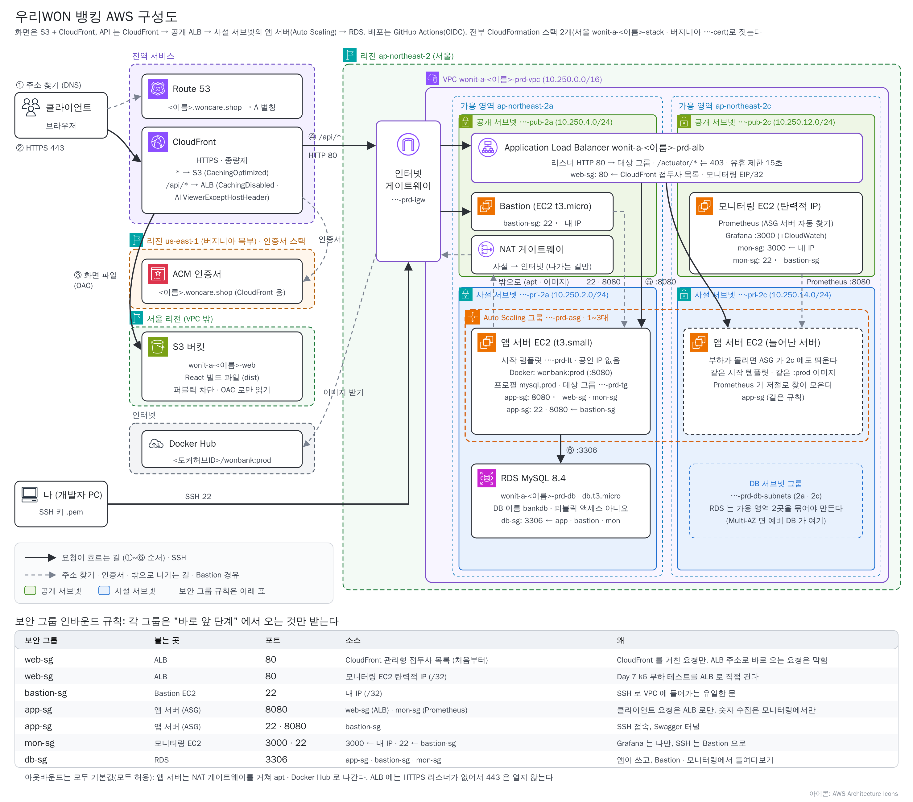

# Day 5. AWS ①: 스택 한 번으로 전부 짓기 + 서버 CI/CD

> 태그 `t8-prod` · 시작 코드 `t7-docker`<br>
> 앞 단계: Day 4 Docker → **Day 5** → 다음: [Day 6 화면 자동 배포 · 모니터링](day6-cicd-monitoring.md)

> 🆘 **늦었을 때**: 코드는 오늘 끝 모양인 `t8-prod` 로 맞춥니다. 스택은 7교시 그대로 만들면 됩니다 (5교시 준비물 3가지 + 6교시 `:prod` 이미지만 있으면 됩니다).
>
> ```bash
> git fetch origin --tags --force && git switch -c my-t8 t8-prod
> ```
>
> 이어서 6-2 의 마지막(`cp ci/backend.yml .github/workflows/`)과 6-3 부터 하면 됩니다. **Docker Hub 계정**(Day 4)과 **GitHub 계정**이 필요합니다.

## 🗺 오늘의 그림



**오늘 그림 전체를 스택 하나로 짓습니다.** 건물(VPC), 공개 층의 ALB · Bastion · NAT, 사설 층의 앱 서버와 금고실(RDS), 화면 창고(S3), 안내 데스크(CloudFront), 간판 주소(Route 53), 상황판 서버(모니터링 EC2), GitHub 방문증 역할까지 한 번에 생깁니다. 내가 하는 일은 **빈칸(파라미터)을 채워 스택을 올리고, 무엇이 생겼는지 읽는 것**입니다.

## 🎯 오늘 할 일

1. 키 페어 · 도메인 · HTTPS 인증서(스택 ①)를 준비하고, push 한 번에 **테스트 → 이미지 → `:prod`** 가 도는 서버 CI 를 켭니다.
2. 스택 ②(`infra/wonit-a-aws.yaml`)로 전부 짓고, 콘솔에서 **무엇이 생겼는지** 읽습니다.
3. 서버를 꺼서 **자가 치유**를 보고, push 한 번에 **서버가 교체**되게 합니다 (서버 CD).

## ⏱ 흐름

| 교시 | 카드 | 미니실습 (15분) | 산출물 |
|---|---|---|---|
| 5 | 5-0 먼저 알기 / 5-1 리전 · IP / 5-2 키 페어 / 5-3 도메인 / 5-4 인증서 스택 | `nslookup` NS 비교 | 키 페어 · 호스팅 영역 ID · **CertificateArn** |
| 6 | 6-0 먼저 알기 / 6-1 fork / 6-2 운영 코드 / 6-3 토큰 · push | 테스트를 일부러 깨뜨리기 | Actions 초록, Docker Hub 의 `:prod` |
| 7 | 7-1 스택 만들기 / 7-2 기다리며 읽기 / 7-3 출력 · 첫 API | 템플릿 구역 찾기 | 스택 `CREATE_COMPLETE`, 내 도메인의 로그인 |
| 8 | 8-1 둘러보기 / 8-2 자가 치유 / 8-3 서버 CD | 교체 중에도 API 되는지 | push 한 번에 **서버 교체** |

## 💰 요금 한 줄

스택이 서 있는 동안 1명 **시간당 약 $0.25 안팎**입니다 (NAT 게이트웨이 · ALB · EC2 3대(앱 · 모니터링 t3.small, Bastion t3.micro) · RDS). CloudFront · S3 는 수업 사용량이면 거의 0 입니다. **Day 7 끝에서 지웁니다.**

---

# 5교시. 준비: 리전 · 키 페어 · 도메인 · 인증서 스택

## 🃏 카드 5-0. 먼저 알기: AWS 큰 그림과 CloudFormation (10분)

**한 줄로**: 건물을 손으로 짓지 않고 **설계도 파일(템플릿)** 에 빈칸만 채워 올리면, AWS 가 **건물 한 채(스택)** 를 지어 줍니다.

비유: 설계도 한 장으로 은행 지점을 통째로 짓고, 철거할 때도 한 번에 허뭅니다.

```
템플릿(.yaml) ──빈칸(파라미터) 채워 올림──▶ 스택 ──▶ VPC · ALB · 서버 · DB · 화면 창고 …
                                            └──▶ 다 짓고 받는 열쇠 꾸러미(출력): 주소 · ID · ARN
스택 삭제 ──▶ 안에 든 것이 같이 지워진다 (정리가 한 번)
```

| 말 | 뜻 | 우리 것 |
|---|---|---|
| **리전** | 도시마다 따로 있는 AWS 지점 | 서울 (인증서만 버지니아) |
| **VPC · 서브넷** | 건물 · 층. 공개 층은 길가, 사설 층은 안쪽 | 공개: ALB · Bastion · NAT / 사설: 앱 서버 · RDS |
| **NAT · Bastion** | 안쪽 층이 밖으로 나가는 우편 창구 / 관리자가 들어오는 쪽문 | 앱 서버는 공인 IP 없음 |
| **보안 그룹** | 출입 명부. "바로 앞 단계에서 온 것만" | 5개 (8-1 표) |
| **템플릿 · 스택** | 설계도 파일 / 그 설계도로 지은 건물 한 채 | `infra/wonit-a-aws.yaml` / `wonit-a-<이름>-stack` |
| **파라미터 · 출력** | 설계도의 빈칸 / 다 짓고 받는 열쇠 꾸러미 | 칸 19개 / SiteUrl · AsgName … |

### 🧩 체크
1. 스택을 삭제하면 그 안에서 만든 ALB 와 서버는 어떻게 되나요?
2. 파라미터와 출력의 차이는?
<details><summary>정답 보기</summary>

1. 같이 지워집니다. 정리가 한 번입니다.
2. 파라미터는 지을 때 **내가 넣는** 값, 출력은 다 짓고 **받는** 값(주소 · ID)입니다.

</details>

## 🃏 카드 5-1. 콘솔 · 리전 · 이름 규칙

**한 줄로**: 은행 지점은 도시마다 따로 있으니 오른쪽 위 도시(리전)를 먼저 봅니다.

**따라 하기**
1. **콘솔 오른쪽 위 리전 메뉴 → 아시아 태평양(서울) ap-northeast-2** 를 고릅니다.
2. 이름은 `wonit-a-<이름>-…`(영문 소문자 · 숫자 · 하이픈, 2~16자), 태그는 `Owner` = `<이름>` 입니다.

**✅ 되었으면**: 오른쪽 위에 **서울**.

**⚠️ 틀리기 쉬운 곳**
- 만든 자원이 목록에 안 보임 → 지워진 게 아니라 **리전이 다른 것**입니다.

## 🃏 카드 5-2. 키 페어

**한 줄로**: 서버 문을 여는 **열쇠 파일**입니다. 스택이 만드는 서버 3대가 이 열쇠를 씁니다.

**따라 하기**
1. **EC2 → 키 페어 → 키 페어 생성** → 이름 `wonit-a-<이름>-key`, 유형 **RSA**, 형식 **`.pem`** → 생성 (`.pem` 이 내려받아집니다).
2. **내 PC (Git Bash)** → 옮기고 나만 읽게 합니다.
   ```bash
   mkdir -p ~/.ssh && mv ~/Downloads/wonit-a-<이름>-key.pem ~/.ssh/
   chmod 400 ~/.ssh/wonit-a-<이름>-key.pem && ls -l ~/.ssh/wonit-a-<이름>-key.pem
   ```

**✅ 되었으면**: `ls -l` 맨 앞이 `-r--------`.

**⚠️ 틀리기 쉬운 곳**
- `.pem` 은 만들 때 **한 번만** 받습니다. 잃으면 새로 만듭니다. 깃 · 메신저에 올리지 않습니다.
- 키 페어는 **서울**에 만듭니다 (스택이 서울 목록에서 고릅니다).

## 🃏 카드 5-3. 내 도메인: 호스팅 영역과 NS 등록

**한 줄로**: 지점 간판 주소 `<이름>.woncare.shop` 의 **전화번호부(호스팅 영역)** 를 만들고, 상위 도메인에 "이 번호부를 보세요" 라고 알립니다.

**따라 하기**
1. **Route 53 → 호스팅 영역 → 호스팅 영역 생성** → 도메인 이름 `<이름>.woncare.shop`, 유형 **퍼블릭 호스팅 영역**, 태그 `Owner` → 생성.
2. 만든 영역의 **NS 레코드 4줄**(`ns-…awsdns-….org`)과 **호스팅 영역 ID**(`Z` 로 시작)를 메모합니다.
   
3. 수업 때 안내하는 **발급 사이트**에서 하위 도메인 `<이름>` 을 등록하고 NS 4개를 붙여 넣습니다.
4. **내 PC (Git Bash)** → NS 4줄이 나오는지 봅니다.
   ```bash
   nslookup -type=NS <이름>.woncare.shop
   ```

**✅ 되었으면**: `nslookup` 의 NS 4줄이 Route 53 의 4줄과 같고, `Z…` 호스팅 영역 ID 가 메모되어 있습니다.

**⚠️ 틀리기 쉬운 곳**
- `Non-existent domain` → 발급 사이트 등록 전이거나 반영 전입니다. 몇 분 뒤 다시.
- 이름은 영문 소문자 · 숫자 · 하이픈 2~32자, `www` `admin` `api` `test` 같은 예약어는 안 됩니다. `nslookup` 이 없으면 PowerShell `Resolve-DnsName -Type NS <이름>.woncare.shop`.

## 🃏 카드 5-4. 인증서 스택 (버지니아)

**한 줄로**: 주소의 **사업자 등록증**(HTTPS 자물쇠)을 스택 ①로 받습니다. CloudFront 는 **버지니아(us-east-1)** 의 인증서만 읽습니다.

**따라 하기**
1. **내 PC (Git Bash)** → 설계도 두 개(`infra/`)와 CI 파일(`ci/`)을 완성본에서 받아 옵니다.
   ```bash
   git fetch origin --tags --force
   git checkout t8-prod -- infra ci
   ```
2. **콘솔 오른쪽 위 리전 → 미국 동부(버지니아 북부) us-east-1** 로 바꿉니다.
3. **CloudFormation → 스택 → 스택 생성 → 기존 템플릿 선택** → **템플릿 파일 업로드** → `infra/wonit-a-cert.yaml` → 다음.
4. 스택 이름과 파라미터를 채웁니다.

| 칸 | 값 |
|---|---|
| 스택 이름 | `wonit-a-<이름>-cert` |
| `YourName` | `<이름>` |
| `DomainName` | `<이름>.woncare.shop` |
| `HostedZoneId` | 5-3 에서 메모한 `Z…` |

   
5. 다음 → 태그 `Owner` = `<이름>` → 다음 → **전송**. 5~10분 뒤 **CREATE_COMPLETE** 가 됩니다.
6. **출력 탭 → `CertificateArn`** 값(`arn:aws:acm:us-east-1:…`)을 메모합니다.
   
7. 콘솔 오른쪽 위 리전을 **서울로 되돌립니다.**

**✅ 되었으면**: 스택 `wonit-a-<이름>-cert` 가 `CREATE_COMPLETE`, `CertificateArn` 이 메모되어 있고 리전이 서울입니다.

**⚠️ 틀리기 쉬운 곳**
- 오래 `CREATE_IN_PROGRESS` → NS 위임이 안 된 것입니다 (5-3 의 `nslookup` 을 다시).
- 서울에서 만들면 `Rules` 오류(`OnlyVirginia`)로 멈춥니다. 리전을 눈으로 확인합니다.

### ✍️ 해 보기 (15분)
리전을 **버지니아** 로 바꿔 EC2 → 키 페어에 내 키가 **안 보이는 것**을 확인하고 서울로 돌아옵니다. `nslookup` 의 NS 4줄과 Route 53 의 4줄을 한 줄씩 비교합니다.

### 🧩 체크
1. 리전을 바꿨더니 내 키 페어가 없습니다. 지워진 걸까요?
2. 인증서 스택만 버지니아에 따로 만든 이유는?
<details><summary>정답 보기</summary>

1. 아닙니다. 자원은 **리전마다 따로** 보입니다. 서울로 돌리면 다시 보입니다.
2. CloudFront 가 `us-east-1` 의 인증서만 읽기 때문입니다. 나머지는 모두 서울 스택입니다.

</details>

# 6교시. 서버 CI: push 하면 테스트하고 이미지를 만든다

> 💡 **이 교시의 목표**: push 한 번에 GitHub Actions 가 **테스트 → 이미지 → `:prod` 이름표**까지 해 줍니다. **이 `:prod` 이미지가 7교시 스택보다 먼저 있어야** 앱 서버가 정상(healthy)이 됩니다. 초록이 될 때까지 7교시로 넘어가지 않습니다.

## 🃏 카드 6-0. 먼저 알기: CI/CD 와 GitHub Actions (10분)

**한 줄로**: **GitHub Actions** 는 저장소에 적어 둔 작업 순서(workflow 파일)를, push 때마다 GitHub 가 빌려주는 컴퓨터에서 대신 실행해 주는 서비스입니다.

비유: workflow 는 업무 절차서 한 권, runner 는 일을 대신 해 주는 임시 직원입니다.

```
내 PC ── git push ──▶ GitHub (내 fork)
                       │  .github/workflows/ 의 yml 을 읽는다
                       ▼
                    runner (임시 Ubuntu): job → step 차례로. 하나라도 실패하면 거기서 멈춤 (빨간 X)
                       ▼  끝나면 버려지고, 결과는 Actions 탭에 남는다
```

| 말 | 뜻 | 오늘 |
|---|---|---|
| **CI** / **CD** | 코드가 올라오면 자동 **테스트 · 이미지 만들기** / 만든 이미지를 **서버에 자동 내보내기** | 6교시 CI / 8교시 CD |
| **workflow** | 작업 순서 한 권. `.github/workflows/` 안에 있어야 읽힌다 | `backend.yml` |
| **`on:`** | 언제 돌릴지 | `main` 에 push |
| **job · `needs:`** | runner 한 대의 일 묶음 / "앞 job 이 성공해야 시작" | `test` → `build` → `deploy` |
| **step** (`uses:` · `run:`) | job 안의 한 동작. 남의 동작 가져다 쓰기 / 명령 한 줄 | `./gradlew test` |
| **`vars.` · `secrets.` · `if:`** | 보여도 되는 값 / 가려지는 값 / 조건이 맞을 때만 (아니면 **건너뜀**) | 6-3 에서 넣는다 |

### 🧩 체크
1. CI 와 CD 는 각각 무엇을 자동으로 하나요?
2. workflow 파일을 `ci/` 폴더에만 두고 push 하면 왜 아무 일도 안 일어나나요?
<details><summary>정답 보기</summary>

1. CI 는 테스트하고 이미지를 만들어 두는 것, CD 는 그 이미지를 서버에 내보내는 것입니다.
2. GitHub 는 `.github/workflows/` 안의 yml 만 읽습니다.

</details>

## 🃏 카드 6-1. fork 하고 Actions 켜기

**한 줄로**: Actions 는 **내 저장소**에서 돌기 때문에, 수업 저장소를 내 것으로 복사(fork)해 둡니다.

**따라 하기**
1. **GitHub 수업 저장소 → 오른쪽 위 Fork → Create fork**
2. **내 fork → Actions 탭** → 워크플로를 켜는 버튼이 보이면 누릅니다 (바로 목록이 보이면 이미 켜진 것).
   
3. **내 PC (Git Bash)** → 내 브랜치를 만들고 내 fork 를 두 번째 주소 `mine` 으로 등록합니다 (`origin` 은 태그를 받는 수업 저장소로 둡니다).
   ```bash
   git switch -c my-t8 t7-docker                # Day 4 브랜치가 있으면 거기서 이어도 됩니다
   git remote add mine https://github.com/<GitHub 아이디>/<저장소 이름>.git
   git remote -v                                # origin 과 mine 이 두 줄씩 보이면 성공
   ```

**✅ 되었으면**: `git remote -v` 에 `mine  https://github.com/<내 아이디>/…` 가 `(fetch)` · `(push)` 로 나옵니다.

**⚠️ 틀리기 쉬운 곳**
- `already exists` → 이미 등록된 것이니 `git remote -v` 로 확인합니다. `mine` 주소는 **GitHub** 아이디입니다 (Docker Hub 와 섞지 않습니다).

## 🃏 카드 6-2. 운영 코드 두 곳과 workflow 놓기

**한 줄로**: 같은 도시락(이미지)에 운영용 양념(설정 파일 하나와 한 줄)만 얹고, 업무 절차서를 `.github/workflows/` 에 놓습니다.

**따라 하기**
1. `infra/` 와 `ci/` 는 5-4 에서 **이미 받았습니다.** 앱 코드는 **두 곳만** 고칩니다 (시작 코드 `t7-docker`).
2. `src/main/resources/application-prod.yml` (새 파일)
   ```yaml
   # 운영 설정: mysql 위에 겹쳐 쓴다 (SPRING_PROFILES_ACTIVE=mysql,prod)
   spring:
     jpa:
       show-sql: false
       properties:
         hibernate:
           format_sql: false
     datasource:
       hikari:
         maximum-pool-size: ${DB_POOL_SIZE:10}   # DB 연결 개수(창구 직원 수)
   logging:
     level:
       com.example.wonit: INFO
       org.hibernate.SQL: WARN
       org.hibernate.orm.jdbc.bind: "OFF"      # 비밀번호 해시 같은 실제 값이 로그에 남는다
       org.springframework.orm.jpa.JpaTransactionManager: INFO
       org.springframework.ai.chat.client.advisor.SimpleLoggerAdvisor: "OFF"   # AI 에 보낸 고객 정보가 통째로 남는다
   jwt:
     secret: ${JWT_SECRET}      # 기본값 없음: 환경변수가 없으면 앱이 뜨지 않는다 (Fail-Fast)
   ```
3. `src/main/java/com/example/wonit/common/WebConfig.java` 의 `allowedOrigins` 한 줄 (`myname` 을 **내 이름** 으로)
   ```java
   .allowedOrigins("http://localhost:5173", "https://myname.woncare.shop")   // 🚨 "*" 로 모두에게 열지 않는다
   ```
4. **내 PC (Git Bash)** → 완성본과 비교합니다. `WebConfig.java` 말고 **차이가 안 나오면 같은 것**입니다. 이어서 workflow 를 Actions 가 읽는 자리로 복사합니다.
   ```bash
   git add src && git diff --cached t8-prod --stat -- src
   mkdir -p .github/workflows && cp ci/backend.yml .github/workflows/
   ```

| `backend.yml` 의 부분 | 뜻 |
|---|---|
| `on: push: branches: [main]` | main 에 push 하면 돈다 (화면 · 문서만 바뀐 push 는 건너뜀) |
| `test` → `build` → `deploy` | 앞 잡이 성공해야 다음. 깨지면 빨간 X |
| `deploy` 의 `imagetools create` | 이번 커밋 이미지에 **`:prod` 이름표**를 붙인다 (서버는 늘 `:prod` 를 받는다) |
| `if: vars.ASG_NAME != ''` | 변수가 있을 때만 AWS 에 들어가 서버를 교체한다. 8교시 전까지 **"건너뜀"** |

**✅ 되었으면**: `git diff` 에 `WebConfig.java` 말고 다른 파일이 없고, `.github/workflows/backend.yml` 이 있습니다.

**⚠️ 틀리기 쉬운 곳**
- 폴더 이름은 정확히 `.github/workflows/` 입니다. YAML 들여쓰기는 스페이스 2칸만 문법입니다.
- YAML 의 `"OFF"` 는 **따옴표**가 있어야 합니다 (없으면 `false` 로 읽힘).
- `WebConfig` 허락 목록에 내 도메인이 없으면 CloudFront 를 거친 `POST` 가 `403 Invalid CORS request` 입니다 (끝에 `/` 도 안 됩니다). `jwt.secret` 은 스택의 `JwtSecret` 이 채웁니다.

## 🃏 카드 6-3. 토큰 · 변수 · 시크릿을 넣고 push 하기

**한 줄로**: Docker Hub 에는 비밀번호 대신 **취소할 수 있는 열쇠(토큰)** 를 맡깁니다. 아이디는 변수, 토큰은 시크릿입니다.

**따라 하기**
1. **Docker Hub → 오른쪽 위 내 아이콘 → Account settings → Personal access tokens → Generate new token** → 설명 `wonbank-github`, 권한 **Read & Write** → 만든 뒤 나오는 토큰을 **복사**합니다 (화면을 닫으면 다시 못 봅니다).
   
2. **내 fork → Settings → Secrets and variables → Actions** 에서 두 개를 넣습니다.

| 탭 | Name | 값 |
|---|---|---|
| **Variables** | `DOCKERHUB_USERNAME` | 내 **Docker Hub** 아이디 (GitHub 아이디가 아님) |
| **Secrets** | `DOCKERHUB_TOKEN` | 1번에서 복사한 토큰 |

   
3. **내 PC (Git Bash)** → 올립니다. 처음 한 번은 내 fork 의 `main` 을 이 브랜치로 덮어씁니다.
   ```bash
   git add .github ci infra src
   git commit -m "feat: 운영 설정 + CI workflow"
   git push mine HEAD:main --force
   ```
4. **내 fork → Actions 탭 → backend** → 방금 실행에서 `test → build → deploy` 가 모두 초록이 됩니다 (몇 분). deploy 의 AWS 두 단계는 **회색 "건너뜀"** 이 정상입니다.
   
5. **Docker Hub → 내 저장소 `wonbank` → Tags** 에 긴 영문 · 숫자 태그와 **`prod`** 가 있고 `linux/amd64` 가 보입니다. 저장소는 **공개**여야 서버가 받습니다.
   

**✅ 되었으면**: Actions 세 칸이 초록이고, Docker Hub 에 `prod` 와 긴 태그가 보입니다.

**⚠️ 틀리기 쉬운 곳**
- `Username required` → 변수가 비었습니다. 시크릿 쪽에 넣으면 `vars.` 가 못 읽습니다.
- `unauthorized: incorrect username or password` → 시크릿 이름 오타 · 토큰 잘림 · 읽기 전용 토큰. 토큰을 다시 만들어 덮어씁니다.
- 🚨 초록이 아니면 7교시 서버가 `:prod` 를 못 받아 unhealthy 입니다.

### ✍️ 해 보기 (15분)
`src/test/java/com/example/wonit/AuthFlowTest.java` 의 `status().isCreated()` 하나를 `status().isOk()` 로 바꿔 push → test 빨간 X, build · deploy 회색을 확인하고, **반드시 되돌립니다** (`git revert --no-edit HEAD && git push mine HEAD:main`).

### 🧩 체크
1. test 가 실패하면 build · deploy 는 어떻게 되나요? 어느 줄 덕분인가요?
2. `DOCKERHUB_USERNAME` 은 변수, `DOCKERHUB_TOKEN` 은 시크릿인 이유는?
<details><summary>정답 보기</summary>

1. 건너뜁니다(회색). `needs:` 가 "앞 잡이 성공해야 시작" 이기 때문입니다.
2. 아이디는 이미지 이름에 들어가 보여도 되고, 토큰은 로그에서도 `***` 로 가려져야 하기 때문입니다.

</details>

# 7교시. 스택 하나로 전부 짓기

## 🃏 카드 7-1. 서울 스택 만들기

**한 줄로**: 빈칸 19개를 채워 `infra/wonit-a-aws.yaml` 을 올리면 건물부터 서버 · DB · 화면 창고 · 상황판까지 한 번에 지어집니다.

**따라 하기**
1. 준비물 5가지: 키 페어(5-2) · `CertificateArn`(5-4) · 호스팅 영역 `Z…`(5-3) · Docker Hub 의 `:prod`(6-3) · 내 fork(`아이디/저장소`). **IAM → ID 제공업체** 에 `token.actions.githubusercontent.com` 이 **이미 있는지** 확인만 합니다 (계정에 하나면 모두 같이 씁니다).
2. 비밀값 칸(`JwtSecret` · `DbPassword` · `GrafanaPassword`)은 수업용 기본값이 들어 있어 그대로 둡니다.
3. 리전이 **서울**인지 보고 **CloudFormation → 스택 → 스택 생성 → 기존 템플릿 선택** → **템플릿 파일 업로드** → `infra/wonit-a-aws.yaml` → 다음.
4. 스택 이름 `wonit-a-<이름>-stack`, 파라미터는 아래처럼 채웁니다.

| 칸 | 넣을 값 | 메모 |
|---|---|---|
| `YourName` | `<이름>` | 소문자 2~16자 |
| `KeyName` | `wonit-a-<이름>-key` | 목록에서 고름 |
| `MyIpCidr` | 기본값 `0.0.0.0/0` 그대로 | Bastion · Grafana 문을 누구에게 열지 (수업은 전체 공개, 실무는 `<내 IP>/32`) |
| `DockerImage` | `<도커허브ID>/wonbank:prod` | 6교시 결과 |
| `JwtSecret` | 기본값 `replace-with-a-long-random-secret-key` 그대로 | 가려져 보임 |
| `GeminiApiKey` | 기본값 `no-key` | AI 키가 있으면 넣고, 없으면 AI 는 대체 답변 |
| `DbUsername` · `DbPassword` | 기본값 `admin` · `Wooriwon1!` 그대로 | DB 계정 |
| `DomainName` | `<이름>.woncare.shop` | 인증서 스택과 같게 |
| `HostedZoneId` | `Z…` | 5-3 |
| `CertificateArn` | `arn:aws:acm:us-east-1:…` | 5-4 (서울 인증서는 거부됨) |
| `CloudFrontPrefixListId` | 기본값 `pl-22a6434b` | 바꾸지 않음 (📖) |
| `GitHubRepo` | `<GitHub 아이디>/<저장소 이름>` | 배포 역할이 이 저장소의 main 만 받음 |
| `GrafanaPassword` | 기본값 `Wooriwon1!` 그대로 | Grafana 로그인 비밀번호 (Day 6) |
| `InstanceType` · `DbInstanceClass` · `DbPoolSize` · `DesiredCapacity` · `RequestsPerTargetPerMinute` | 기본값 그대로 | Day 7 에서 일부를 바꿔 봄 |

   
5. 다음 → **스택 옵션 구성** 화면에서 태그 `Owner` = `<이름>` 을 넣고, 같은 화면 맨 아래 **기능** 의 **IAM 리소스를 생성할 수 있음을 승인합니다**(역할 2개를 만듭니다)에 **체크** → 다음 → **전송**. 15~20분 걸립니다.

**✅ 되었으면**: 스택 `wonit-a-<이름>-stack` 이 **CREATE_IN_PROGRESS** 로 시작했습니다.

**⚠️ 틀리기 쉬운 곳**
- 칸이 빨갛게 거부 → 모양 규칙입니다 (`MyIpCidr` 는 `…/숫자` 모양, `CertificateArn` 은 `us-east-1`, `DbPassword` 에 `/ @ "` 와 공백 불가).
- `ROLLBACK` → **이벤트 탭의 첫 실패 줄**을 읽고 스택을 **삭제한 뒤** 다시 만듭니다.
- 공급자가 없으면: **IAM → 자격 증명 공급자 → 공급자 추가 → OpenID Connect**, URL `https://token.actions.githubusercontent.com`, 대상 `sts.amazonaws.com`.

<details><summary>📖 더 알아보기</summary>

- `CloudFrontPrefixListId` 는 "CloudFront 가 쓰는 주소 모음" 입니다. **VPC → 관리형 접두사 목록** 에서 이 ID 가 `com.amazonaws.global.cloudfront.origin-facing` 인지 볼 수 있습니다.
- 🚨 DB 암호 · JWT 비밀키 · Grafana 비밀번호는 서버의 사용자 데이터에 들어가 EC2 콘솔에서 보입니다. 수업용이고, 실무는 Secrets Manager 를 씁니다.

</details>

## 🃏 카드 7-2. 기다리는 동안: 스택이 무엇을 짓는지 읽기

**한 줄로**: 15분 동안 **이벤트 탭**에서 생기는 순서를 보고, 템플릿 구역이 무엇을 만드는지 표로 읽습니다.

**따라 하기**
1. **CloudFormation → 스택 → `wonit-a-<이름>-stack` → 이벤트** 탭을 새로고침하며 봅니다 (맨 위가 최신). 네트워크 → 보안 그룹 → RDS → ALB … 순으로 `CREATE_COMPLETE` 가 늘어납니다.
   
2. **리소스** 탭에서 이름을 눌러 보면 해당 콘솔로 넘어갑니다. **템플릿** 탭의 `# 01.` `# 05.` … 구역 주석이 아래 표의 번호입니다.

| 구역 | 만드는 것 | 은행 비유 |
|---|---|---|
| 01 | VPC · 서브넷 4 · 인터넷 게이트웨이 · **NAT 게이트웨이** | 건물, 길가/안쪽 층, 우편 창구 |
| 05 (앞) | 보안 그룹 5개 | 층마다 출입 명부 |
| 03 | RDS MySQL (사설 서브넷, 퍼블릭 아님) | 지하 금고실 |
| 04 | 앱 서버 **시작 템플릿** (아래 발췌) | 신입 직원 업무 매뉴얼 |
| 05 (뒤) | 대상 그룹 · ALB · 리스너(`/actuator/*` 는 403) | 창구 목록, 번호표 안내원 |
| 06 | **Auto Scaling 그룹** · 요청 수 기준 확장 정책 | 인사팀 |
| 07 | 모니터링 EC2 (켜지면서 Prometheus · Grafana) · **Bastion** | 기록원 방 · 쪽문 |
| 08 | GitHub 배포 **역할(OIDC)** | 일회용 방문증 |
| 09 | S3 · CloudFront · Route 53 별칭 | 서류 창고, 안내 데스크, 간판 주소 |

```bash
# 04 구역: 서버가 켜질 때 한 번 실행되는 사용자 데이터 (발췌)
apt-get install -y docker.io                  # Docker 설치
cat > /opt/wonbank.env <<'EOF' ...            # DB 주소 · 암호 · JWT 비밀키를 파일로 (스택의 파라미터가 들어간다)
docker run -d --name wonbank --restart unless-stopped -p 8080:8080 --env-file /opt/wonbank.env ${DockerImage}
```

**✅ 되었으면**: 이벤트 탭에서 RDS 와 CloudFront 가 가장 오래 걸리는 것을 봤고, 표의 9개 구역을 템플릿 탭에서 찾았습니다.

**⚠️ 틀리기 쉬운 곳**
- 빨간 `CREATE_FAILED` 는 그 줄의 이유(Status reason)를 읽습니다. 서버는 켜질 때 `:prod` 를 **한 번** 받아서, 8교시 CD 가 "서버 교체" 입니다.

## 🃏 카드 7-3. 다 지어졌으면: 출력 읽기와 첫 API

**한 줄로**: 스택이 건네는 **열쇠 꾸러미(출력)** 를 받고, 내 도메인으로 회원가입과 로그인을 해 봅니다.

**따라 하기**
1. 스택이 **CREATE_COMPLETE** 가 되면 **출력** 탭을 엽니다.
   

| 출력 | 어디에 쓰나 |
|---|---|
| `SiteUrl` | 내 사이트 주소 `https://<이름>.woncare.shop` (화면은 Day 6 에 올라감) |
| `AsgName` · `DeployRoleArn` | 8교시 GitHub 변수 `ASG_NAME` · `AWS_DEPLOY_ROLE_ARN` |
| `WebBucketName` · `CloudFrontDistributionId` | Day 6 GitHub 변수 `WEB_BUCKET` · `CF_DISTRIBUTION_ID` |
| `GrafanaUrl` | Day 6 12교시 상황판 주소 |
| `AlbDnsName` | Day 7 부하 테스트 대상 |
| `BastionIp` · `AppSsh` · `MonitoringSsh` | 쪽문 주소, 앱 서버 / 모니터링 EC2 에 SSH 하는 명령 (8-3 · Day 7) |
| `SwaggerTunnel` · `RdsEndpoint` | (선택) Swagger 터널 명령 / 참고용 DB 주소 (이미 서버 설정에 들어 있음) |

2. **내 PC (Git Bash)** → 회원가입 → 로그인합니다 (암호는 4자 이상). 로그인 응답에 `accessToken` 이 있으면 성공입니다.
   ```bash
   curl -s -X POST https://<이름>.woncare.shop/api/auth/signup -H 'Content-Type: application/json' -d '{"loginId":"<아이디>","password":"<암호>","name":"<이름>"}'
   curl -s -X POST https://<이름>.woncare.shop/api/auth/login -H 'Content-Type: application/json' -d '{"loginId":"<아이디>","password":"<암호>"}'
   ```
3. 브라우저로 `https://<이름>.woncare.shop` 을 엽니다. 자물쇠는 보이고 화면은 **403 이나 빈 화면**이 정상입니다 (화면 파일은 Day 6).

**✅ 되었으면**: 가입이 201, 로그인이 `accessToken` 을 돌려줍니다.

**⚠️ 틀리기 쉬운 곳**
- `502` · `503` → 앱 서버가 아직 켜지는 중입니다 (첫 부팅 3~4분). 8-1 의 대상 그룹이 healthy 가 될 때까지 기다립니다.
- `Could not resolve host` → 주소 반영 전입니다. 1~2분 뒤 다시. `POST` 가 `403 Invalid CORS request` 면 6-2 의 `WebConfig` 주소를 봅니다.

### ✍️ 해 보기 (15분)
템플릿 탭에서 `# 05.` 구역의 보안 그룹 5개를 세어 보고, 출력 중 8교시에 쓸 2개(`DeployRoleArn` · `AsgName`)를 메모장에 복사해 둡니다.

### 🧩 체크
1. 파라미터 `DockerImage` 를 `:prod` 로 정한 이유는?
2. 로그인 요청은 어느 길로 서버에 도착하나요?
<details><summary>정답 보기</summary>

1. 서버가 켜질 때 `:prod` 가 가리키는 이미지를 받기 때문입니다. CI 가 이름표만 옮기면 다음에 뜨는 서버는 새 코드입니다.
2. 브라우저 → Route 53 → CloudFront(`/api/*`) → ALB → 앱 서버(사설 서브넷) → RDS 입니다.

</details>

# 8교시. 둘러보기 · 자가 치유 · 서버 CD

## 🃏 카드 8-1. 스택이 만든 것 둘러보기

**한 줄로**: 콘솔 화면을 열어 "내가 쓴 설계도가 실제로 이렇게 생겼구나" 를 눈으로 확인합니다.

**따라 하기**
1. **VPC → 내 VPC `wonit-a-<이름>-prd-vpc` → 리소스 맵**: 서브넷 4개(공개 2 · 사설 2), 인터넷 게이트웨이, **NAT 게이트웨이**의 연결선을 찾습니다.
   
2. **EC2 → 보안 그룹** 에서 5줄을 보고, `…-app-sg` 의 **인바운드 규칙**에서 8080 의 소스가 `sg-…` 인 것을 확인합니다 (각 그룹은 **바로 앞 단계에서 오는 것만** 받습니다).
   

| 보안 그룹 | 붙는 곳 | 인바운드 |
|---|---|---|
| `…-prd-web-sg` | ALB | 80 ← **CloudFront 접두사 목록** + 모니터링 EC2 탄력적 IP/32 (k6 용) |
| `…-prd-bastion-sg` | Bastion | 22 ← `MyIpCidr` (기본 `0.0.0.0/0`) |
| `…-prd-app-sg` | 앱 서버 | 8080 ← web-sg · mon-sg · bastion-sg, 22 ← bastion-sg |
| `…-prd-mon-sg` | 모니터링 EC2 | 3000 ← `MyIpCidr` (기본 `0.0.0.0/0`), 22 ← bastion-sg |
| `…-prd-db-sg` | RDS | 3306 ← app-sg · bastion-sg · mon-sg |

3. **EC2 → 로드 밸런서 → `…-prd-alb` → 리스너 및 규칙**: HTTP:80 에 `/actuator/*` → 고정 응답 **403** 과 기본 → 대상 그룹. **속성** 탭의 연결 유휴 제한 시간은 **15초**.
   
4. **EC2 → 대상 그룹 → `…-prd-tg` → 대상** 탭에서 서버가 **initial → healthy** 로 바뀔 때까지 새로고침합니다 (첫 부팅 3~4분).
   
5. 나머지는 한 곳씩 열어 봅니다.
   - **EC2 → Auto Scaling 그룹 → `…-prd-asg`**: 서브넷 **사설 2개**, 상태 검사 유예 **300초**, 유지 관리 정책 최소 100% · 최대 200%
   - **RDS → `…-prd-db`**: 퍼블릭 액세스 **아니요** / **CloudFront → 내 배포 → 동작**: `/api/*` → ALB, 기본 `*` → S3 / **Route 53**: `<이름>.woncare.shop` A 별칭

**✅ 되었으면**: 서버가 healthy 이고, 위 표의 값들을 콘솔에서 확인했습니다.

**⚠️ 틀리기 쉬운 곳**
- 서버가 오래 unhealthy → 상태 세부 정보를 읽습니다. 보통 `:prod` 이미지가 없거나(6-3) 저장소가 비공개입니다.
- ALB 주소로 직접 여는 단계는 없습니다. 80 이 CloudFront 에게만 열려 있어 **막히는 것이 정상**입니다.

<details><summary>📖 더 알아보기</summary>

- 앱 서버가 뚫려도 DB 문은 "app-sg 소속" 에게만 열려 있고, 인터넷에서는 앱 서버 · DB 로 가는 길이 없습니다. 나가는 쪽은 NAT 를 거칩니다.
- 유휴 제한 15초: Tomcat 은 놀고 있는 연결을 20초에 끊으니 ALB 가 먼저 닫게 해서 가끔 나는 502 를 막습니다.

</details>

## 🃏 카드 8-2. 자가 치유: 서버를 일부러 끄기

**한 줄로**: 창구 직원이 사라져도 **인사팀(ASG)이 알아채고 새 직원을 채웁니다.**

**따라 하기**
1. **EC2 → 인스턴스** 에서 `wonit-a-<이름>-prd-app` 을 선택 → **인스턴스 상태 → 인스턴스 종료**.
2. **Auto Scaling 그룹 → `…-prd-asg` → 활동** 탭을 새로고침합니다. **종료** 한 줄과 **새 인스턴스 시작** 한 줄이 생깁니다.
   
3. 새 서버가 **healthy** 가 되면(몇 분) 7-3 의 로그인 `curl` 을 다시 칩니다. 같은 아이디로 `accessToken` 이 나옵니다.

**✅ 되었으면**: 활동 탭에 종료 · 시작 두 줄이 있고, 새 인스턴스 ID 가 healthy 이며 로그인이 됩니다.

**⚠️ 틀리기 쉬운 곳**
- 새 서버가 안 생김 → 활동 탭의 실패 사유를 봅니다. 서버가 1대라 교체 중에는 API 가 잠깐 안 됩니다 (계정이 남는 것은 데이터가 RDS 에 있어서).

## 🃏 카드 8-3. 서버 CD: push 하면 서버가 새것으로 교체된다

**한 줄로**: GitHub 에 비밀번호를 맡기지 않고, 스택이 만든 **일회용 방문증(OIDC) 역할**로 AWS 에 들어가 서버를 교체합니다.

**따라 하기**
1. **스택 출력**의 `DeployRoleArn` · `AsgName` 을 복사해 **내 fork → Settings → Secrets and variables → Actions → Variables** 에 넣습니다.

| Name | Value |
|---|---|
| `AWS_DEPLOY_ROLE_ARN` | 출력 `DeployRoleArn` |
| `ASG_NAME` | 출력 `AsgName` (`wonit-a-<이름>-prd-asg`) |

2. **내 PC** → `src/main/resources/application-prod.yml` 의 **첫 줄 주석** 끝에 `(CD 시험)` 을 덧붙입니다 (동작은 그대로, 코드가 바뀌었다는 표시).
3. **내 PC (Git Bash)** → push.
   ```bash
   git add -A && git commit -m "cd: 서버 교체 시험" && git push mine HEAD:main
   ```
4. **내 fork → Actions → backend** → 이번에는 deploy 의 **AWS 두 단계도 초록**입니다.
   
5. **EC2 → Auto Scaling 그룹 → `…-prd-asg` → 인스턴스 새로 고침** 탭이 진행 중에서 **성공**으로 바뀌고, 대상 그룹에 새 인스턴스가 healthy 가 됩니다.
   
6. **롤백**: **Actions → backend** 에서 6-3 의 **예전 성공 실행** → 오른쪽 위 **Re-run all jobs**. 서버가 한 번 더 교체됩니다. 확인 뒤 가장 최근 성공 실행을 Re-run 해서 돌아옵니다.

**✅ 되었으면**: deploy 까지 초록이고, 인스턴스 새로 고침이 **성공**이며 새 서버가 healthy 입니다.

**⚠️ 틀리기 쉬운 곳**
- `Could not assume role` · `Not authorized …` → `AWS_DEPLOY_ROLE_ARN` 복사 잘림 · 스택의 `GitHubRepo` 오타 (대소문자 구분, main 브랜치만 허용).
- AWS 두 단계가 **건너뜀** → `ASG_NAME` 이 **Variables** 탭에 있는지 봅니다.

<details><summary>📖 더 알아보기</summary>

- 역할은 스택이 만들었습니다. **IAM → 역할 → `wonit-a-<이름>-github-deploy-role` → 신뢰 관계**에서 `repo:<아이디>/<저장소>:ref:refs/heads/main` 만 허락한 줄을 읽어 봅니다. 이 `sub` 조건이 없으면 GitHub 의 아무 저장소나 들어올 수 있습니다.
- 교체는 새 서버를 먼저 띄우고(최대 200%) 정상이 되면 옛 서버를 끄므로 끊기지 않습니다. 롤백은 이미지가 SHA 로 남아 있어서 되지만 **DB 는 되돌아가지 않습니다.**

</details>

## 🃏 (선택) 카드 8-4. Bastion 으로 앱 서버에 들어가기 · Swagger 터널

<details><summary>펼치기: 앱 서버는 공인 IP 가 없어 쪽문(Bastion)으로만 들어갑니다</summary>

1. **EC2 → 인스턴스** 에서 앱 서버의 **프라이빗 IPv4** 를 복사합니다.
2. **내 PC (Git Bash)** → `cd ~/.ssh` 후 출력 `AppSsh` 의 `<app private IP>` 를 바꿔 실행합니다. `ubuntu@ip-10-…` 면 앱 서버 안입니다 (`docker logs wonbank --tail 50`, `exit`).
3. Swagger: 출력 `SwaggerTunnel` 명령을 **새 터미널**에 열어 둔 채 `http://localhost:8080/swagger-ui.html` 을 엽니다. 끝나면 `Ctrl+C`.

</details>

### ✍️ 해 보기 (15분)
인스턴스 새로 고침이 도는 동안 7-3 의 로그인 `curl` 을 몇 번 쳐서 끊기는지 보고, push 부터 healthy 까지 · 롤백이 걸린 시간을 적습니다.

### 🧩 체크
1. OIDC 방식은 액세스 키 방식과 비교해 GitHub 에 **무엇이 저장되지 않나요?**
2. 앱 서버를 사설 서브넷에 두면 무엇이 좋고, 그 대가는?
<details><summary>정답 보기</summary>

1. AWS 의 비밀번호(액세스 키)가 저장되지 않습니다. 잡이 도는 동안만 쓰는 임시 자격 증명을 매번 받습니다.
2. 인터넷에서 닿는 길이 없어 공격 면이 줄어듭니다. 대신 NAT · Bastion 의 요금과 관리가 늘어납니다.

</details>

# 🧹 오늘 정리 (체크리스트)
> 자원은 **지우지 않고 둡니다.** Day 7 마지막에 스택을 지웁니다.

- [ ] 인증서 스택 `wonit-a-<이름>-cert`(버지니아) · 서울 스택 `wonit-a-<이름>-stack` 이 `CREATE_COMPLETE`
- [ ] Actions `test → build → deploy` 초록 · 변수 `DOCKERHUB_USERNAME` `AWS_DEPLOY_ROLE_ARN` `ASG_NAME` · 시크릿 `DOCKERHUB_TOKEN` · Docker Hub 공개 저장소의 `:prod`
- [ ] 서버 healthy, `https://<이름>.woncare.shop/api/auth/login` 이 `accessToken` 을 돌려줌
- [ ] push 한 번에 **인스턴스 새로 고침**이 돈다 · 키 페어 `.pem` 을 깃 · 메신저에 올리지 않음

# 🎤 면접
<details><summary>Q1. 콘솔 클릭 대신 CloudFormation 을 쓰는 이유는?</summary>

> 설계도 파일 하나로 같은 환경을 몇 번이든 똑같이 만들고, 한 번에 지울 수 있기 때문입니다. 손으로 만들면 빠뜨린 설정이 생기고 지울 때 남는 자원에 요금이 나가지만, 스택은 만든 것을 모두 알고 있습니다. 파일이 코드라 변경 이력도 남습니다.
</details>

<details><summary>Q2. 앱 서버를 사설 서브넷에 두고 Bastion 으로만 접속하게 한 이유는?</summary>

> 공인 IP 가 없으면 인터넷에서 닿을 길이 없어 공격 면이 줄어듭니다. 보안 그룹은 "바로 앞 단계에서 오는 것만" 받게 했고, 관리 SSH 는 Bastion 한 곳(내 IP 만)으로 모았습니다. 이미지를 받으러 나갈 때만 NAT 를 씁니다. 대신 NAT · Bastion 의 요금과 관리는 감수했습니다.
</details>

<details><summary>Q3. 액세스 키 대신 OIDC 로 배포 권한을 주는 이유는?</summary>

> 액세스 키는 GitHub 에 비밀번호를 저장하는 것이라 새면 지울 때까지 누구나 씁니다. OIDC 는 잡이 돌 때마다 GitHub 가 "내 저장소의 main" 이라는 서명된 증명서를 만들고, AWS 가 역할의 신뢰 관계 조건과 맞춰 본 뒤 짧은 임시 자격 증명을 줍니다. 저장된 비밀이 없고 권한도 내 버킷 · 내 ASG 로 제한했습니다.
</details>
