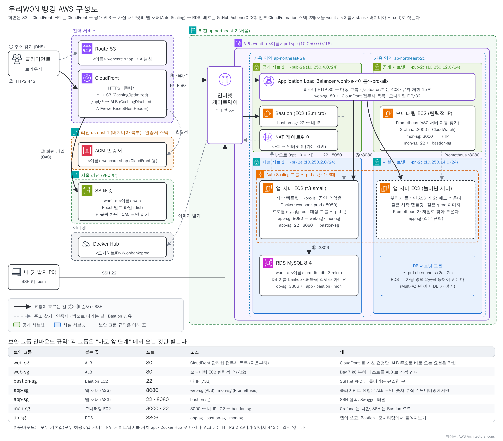

# Day 6. AWS ②: 화면 자동 배포와 모니터링

> 태그 `t9-cicd`(파트 9~10) · `t10-monitoring`(파트 11~12) · 시작 코드 `t8-prod`<br>
> 앞 단계: [Day 5 AWS 서버](day5-aws.md) → **Day 6** → 다음: [Day 7 부하 · 확장](day7-load-scale.md)

> 🆘 **늦었을 때**: 코드는 태그로 맞춥니다. 파트 9~10가 끝난 상태는 `t9-cicd`, 파트 11~12가 끝난 상태는 `t10-monitoring` 입니다. **S3 · CloudFront · 모니터링 서버는 Day 5 의 스택이 이미 다 만들어 두었습니다.** 스택이 없다면 [Day 5](day5-aws.md) 파트 7부터 합니다.
>
> ```bash
> git fetch origin --tags --force && git switch -c my-t9 t9-cicd      # 파트 9부터 늦었다면 t8-prod, 파트 12부터 늦었다면 t10-monitoring
> ```

## 🗺 오늘의 그림



오늘은 그림의 **왼쪽 위 전역 서비스**(Route 53 · CloudFront)와 **S3 창고**, 공개 층의 **모니터링 EC2**(Prometheus · Grafana), GitHub Actions 의 **화면 배포 길**(빌드 → S3 → 무효화)을 다룹니다. 모두 스택이 이미 지어 두었으니, 내가 하는 일은 **읽어 보기 · GitHub 설정 · 코드 몇 줄 · Grafana 화면 작업**입니다.

## 🎯 오늘 할 일

1. 스택이 만든 **S3 · CloudFront · 내 도메인**의 설정을 읽습니다.
2. 화면(`frontend/`)도 push 하면 **빌드 → S3 → 무효화**가 자동으로 돌게 하고, 화면 한 줄을 고쳐 사이트가 바뀌는 것을 봅니다.
3. 서버가 내놓는 숫자(`/actuator/prometheus`)를 여는 코드 세 곳을 넣고 push 합니다.
4. Grafana 에 데이터 소스를 연결하고 대시보드 하나와 **내 패널 2개**를 만듭니다.

## ⏱ 흐름

| 파트 | 카드 | 산출물 |
|---|---|---|
| 9 | 9-0 먼저 알기 / 9-1 S3 보기 / 9-2 CloudFront · 내 도메인 보기 | `nslookup` 은 CloudFront 주소, 화면은 아직 403 |
| 10 | 10-0 먼저 알기 / 10-1 화면 자동 배포 켜기 / 10-2 화면 고쳐 push | `https://<이름>.woncare.shop` 로그인 · 이체 |
| 11 | 11-0 먼저 알기 / 11-1 코드 세 곳 + push | 숫자를 내놓는 서버 (새로 고침 성공) |
| 12 | 12-1 Grafana 들어가기 / 12-2 데이터 소스 · 대시보드 / 12-3 내 패널 | 내 패널 2개가 움직임 |

# 파트 9. 스택이 만든 화면 자리 보기: S3 · CloudFront · 내 도메인

## 🃏 카드 9-0. 먼저 알기: S3 와 CloudFront (10분)

**한 줄로**: 화면은 "계산 없는 파일" 이라 **S3(파일 창고)** 에 두고, **CloudFront(전국 지점의 안내 데스크)** 가 내 도메인 · HTTPS 로 나눠 주며 `/api` 만 ALB 로 넘깁니다.

비유: S3 는 문 잠긴 서류 창고, CloudFront 는 자주 찾는 서류를 복사해 두는 안내 데스크이고 업무 요청(`/api`)은 본점(ALB)으로 넘깁니다.

```
브라우저 ─① <이름>.woncare.shop 이 어디야? ─▶ Route 53 : "CloudFront 로 가세요" (A 별칭)
브라우저 ─② https://<이름>.woncare.shop ───▶ CloudFront (자물쇠 = 버지니아 인증서)
            /  · /assets/… (화면 파일) ──▶ S3 : 복사본 있으면 바로, 없으면 가져와 복사
            /api/… (로그인 · 이체) ──────▶ 복사 없이 매번 ALB → 앱 서버
```

| 말 | 뜻 | 우리 것 |
|---|---|---|
| **버킷 · 퍼블릭 액세스 차단** | S3 의 통 (이름이 전 세계에서 하나) / 인터넷에서 직접 못 열게 잠금 | `wonit-a-<이름>-web`, **켠 그대로** |
| **배포**(Distribution) | CloudFront 하나. 배포 ID(`E…`) 가 생긴다 | `wonit-a-<이름>-web` |
| **원본 · 동작** | 파일을 가지러 가는 곳 / "이 경로는 이 원본으로" 규칙 | 원본 2개(S3 · ALB), 동작 2개 |
| **캐시 정책** | 복사해 둘지 | 화면 `CachingOptimized`, API `CachingDisabled` |
| **OAC · 버킷 정책** | CloudFront 만 잠긴 S3 에서 꺼내 가게 하는 열쇠와 출입 규칙 | `wonit-a-<이름>-web-oac` |

> 📎 개념과 손으로 다시 올리는 법은 [화면 배포 참고 자료](frontend-s3-cloudfront.md) 에 있습니다. 수업은 이 문서의 카드만 따라가면 됩니다.

### 🧩 체크
1. 화면(React)을 EC2 서버 없이 S3 에 두어도 되는 이유는?
2. `/api/…` 응답을 CloudFront 가 복사해 두면 왜 안 되나요?
<details><summary>정답 보기</summary>

1. 빌드한 화면은 HTML · JS · CSS 파일이라 브라우저가 내려받아 스스로 실행합니다. 서버는 `/api` 계산만 합니다.
2. 응답이 사람마다 다릅니다(내 계좌). 복사해 두면 다른 사람에게 내 응답이 나갑니다. 그래서 `/api/*` 는 `CachingDisabled` 입니다.

</details>

## 🃏 카드 9-1. S3 보기: 문 잠긴 빈 창고

**한 줄로**: 스택이 만든 화면 창고는 **비어 있고, 인터넷에서는 잠겨 있고, CloudFront 에게만 열려** 있습니다.

**따라 하기**
1. **S3 → 버킷 → `wonit-a-<이름>-web` → 객체** 탭: 파일이 **0개**입니다 (파트 10 workflow 가 채웁니다).
2. **권한** 탭: **퍼블릭 액세스 차단**이 모두 **켜짐**, **버킷 정책**이 아래 네 줄을 말합니다.

| 줄 | 값 | 뜻 |
|---|---|---|
| `Principal` | `cloudfront.amazonaws.com` | 요청하는 쪽이 CloudFront 일 때 |
| `Action` | `s3:GetObject` | 파일 **읽기만** (올리기 · 지우기 안 됨) |
| `Resource` | `arn:aws:s3:::wonit-a-<이름>-web/*` | 이 버킷의 모든 파일 |
| `Condition` | `AWS:SourceArn` = 내 배포 | 그중 **내 배포에서 온 요청만** |

   

**✅ 되었으면**: 객체 0개, 퍼블릭 차단 모두 켜짐, 버킷 정책의 `Condition` 에 내 배포가 적혀 있습니다.

**⚠️ 틀리기 쉬운 곳**
- 퍼블릭 차단을 끄지 않습니다. 열쇠(OAC)는 CloudFront 에게만 줬습니다.

## 🃏 카드 9-2. CloudFront · 내 도메인 보기

**한 줄로**: 안내 데스크가 **창구 2개(원본)** 와 **안내판 2개(동작)** 로 길을 나누고, 간판 주소(Route 53)가 데스크로 이어져 있는지 봅니다.

**따라 하기**
1. **CloudFront → 배포 → `wonit-a-<이름>-web` → 일반**: **대체 도메인 이름** `<이름>.woncare.shop`, **사용자 지정 SSL 인증서**(5-4 에서 받은 것), **기본 루트 객체** `index.html`.
   
2. **원본** 탭: 두 줄 — `s3-web`(S3 버킷, OAC `wonit-a-<이름>-web-oac`), `alb-api`(ALB DNS, **HTTP 전용 · 80**).
   
3. **동작** 탭: 두 줄을 아래 표와 맞춰 봅니다 (경로가 더 구체적인 동작이 먼저).

| 경로 | 원본 | 캐시 정책 | 메서드 |
|---|---|---|---|
| `/api/*` | `alb-api` | `CachingDisabled` (+ 원본 요청 정책 `AllViewerExceptHostHeader`) | 전부 7개 |
| `Default (*)` | `s3-web` | `CachingOptimized` | GET, HEAD |

   
4. **Route 53 → 호스팅 영역 → `<이름>.woncare.shop`**: 유형 **A**, **별칭** → CloudFront 배포(`dxxxx.cloudfront.net`).
   
5. **EC2 → 보안 그룹 → `…-prd-web-sg` → 인바운드 규칙**: 80 의 소스가 **접두사 목록**(CloudFront origin-facing)과 모니터링 EC2 의 탄력적 IP/32 입니다. ALB 문이 CloudFront 에게만 열린 모습입니다.
   
6. **내 PC (Git Bash)** → 주소와 현재 응답을 봅니다.
   ```bash
   nslookup <이름>.woncare.shop           # 내 서버 IP 가 아니라 CloudFront 주소 여러 개
   curl -sI https://<이름>.woncare.shop/ | head -1   # HTTP/2 403 (창고가 비어 있어 정상)
   ```

**✅ 되었으면**: 동작 두 줄 · 원본 두 개가 보이고, `nslookup` 이 CloudFront 주소를 주며, `curl` 이 `403` 입니다.

**⚠️ 틀리기 쉬운 곳**
- 사이트가 `AccessDenied` / 403 인 것은 **고장이 아닙니다.** 창고가 비어 있어 가져올 파일이 없을 뿐, 파트 10에 화면을 올리면 열립니다.
- `/api/*` 가 `502` · `504` → 서버가 아직 healthy 가 아니거나(Day 5 8-1) 접두사 목록이 틀린 것입니다.

<details><summary>📖 더 알아보기</summary>

- `/api/*` 에 `CachingDisabled` 와 `AllViewerExceptHostHeader` 가 **둘 다** 필요합니다: 응답이 섞이는 것을 막고, `Authorization` 헤더를 서버까지 전달합니다 (없으면 401).
- CloudFront → ALB 구간은 HTTP 입니다. 실무는 ALB 에도 서울 인증서를 붙여 전 구간을 암호화합니다.

</details>

### ✍️ 해 보기 (15분)
`nslookup` 결과의 주소가 CloudFront 것임을 확인하고, S3 버킷 정책의 `Condition` 에 적힌 배포 ARN 이 CloudFront **동작** 탭의 내 배포와 같은 것인지 비교합니다.

### 🧩 체크
1. 지금 사이트를 열었더니 `AccessDenied` 입니다. 고장일까요?
2. S3 가 잠겨 있는데 CloudFront 는 어떻게 파일을 꺼내 가나요?
<details><summary>정답 보기</summary>

1. 고장이 아닙니다. 창고가 비어 있어서입니다.
2. OAC 로 "저 CloudFront 입니다" 하고 서명하고, 버킷 정책이 "내 배포에서 온 읽기" 를 허락하기 때문입니다.

</details>

# 파트 10. 화면 CD: push 하면 사이트가 바뀐다

## 🃏 카드 10-0. 먼저 알기: 화면 workflow (10분)

**한 줄로**: 화면을 올리는 손 3단계(빌드 → S3 → 무효화)를, push 하면 workflow 가 매번 같은 순서로 대신 합니다 (Day 5 의 `backend.yml` 과 같은 구조).

비유: 매번 같은 절차서대로 일하는 임시 직원이 새 간판(화면)을 창고에 넣고 안내 데스크의 옛 사본을 버립니다.

```
frontend/ 를 고쳐 push ─▶ runner: 빌드(dist/) ─▶ S3 에 올리기 ─▶ CloudFront 무효화(옛 사본 버리기)
                          AWS 에는 비밀번호 없이, 스택이 만든 역할로 입장 (OIDC)
```

| 손으로 할 때 | `frontend.yml` 의 step |
|---|---|
| (코드 · Node 가 있다) | `checkout` · `setup-node` · `npm ci` |
| 1. `VITE_API_BASE=/api npm run build` | `npm run build` + `env: VITE_API_BASE: /api` |
| (AWS 로그인) | `configure-aws-credentials` (`vars.AWS_DEPLOY_ROLE_ARN` 역할) |
| 2. S3 에 올리기 | `aws s3 sync dist s3://… --delete` |
| 3. CloudFront 무효화 | `aws cloudfront create-invalidation … '/*'` |

`on: push: paths: ['frontend/**']` 로 **화면이 바뀐 push 에서만** 돌고, `backend.yml` 은 `paths-ignore` 로 화면만 바뀐 push 를 건너뛰어 서로 안 돕니다. `if: vars.WEB_BUCKET != ''` 라서 변수를 넣기 전에는 **건너뜀**입니다.

### 🧩 체크
1. `frontend.yml` 을 `ci/` 에만 두면 왜 돌지 않나요?
2. 화면만 고쳤는데 서버가 다시 교체되지 않는 이유는?
<details><summary>정답 보기</summary>

1. GitHub 는 `.github/workflows/` 안의 yml 만 읽습니다.
2. `backend.yml` 이 `paths-ignore: ['frontend/**', …]` 로 화면만 바뀐 push 를 건너뛰기 때문입니다.

</details>

## 🃏 카드 10-1. 화면 자동 배포 켜기

**한 줄로**: 변수 두 개를 넣고 workflow 를 `.github/workflows/` 에 놓으면, 화면 파일이 창고(S3)에 올라가고 안내 데스크의 옛 사본이 버려집니다.

**따라 하기**
1. **스택 출력**의 값을 **내 fork → Settings → Secrets and variables → Actions → Variables** 에 넣습니다 (`AWS_DEPLOY_ROLE_ARN` 은 Day 5 8-3 에서 넣었습니다).

| Name | Value |
|---|---|
| `WEB_BUCKET` | 출력 `WebBucketName` (`wonit-a-<이름>-web`) |
| `CF_DISTRIBUTION_ID` | 출력 `CloudFrontDistributionId` (`E…`) |

   
2. **내 PC (Git Bash)** → workflow 를 놓아 올립니다. `[skip ci]` 는 이 push 로 서버가 또 교체되지 않게 하는 표시입니다.
   ```bash
   git fetch origin --tags --force
   git checkout t9-cicd -- ci
   cp ci/frontend.yml .github/workflows/
   git add .github ci && git commit -m "ci: 화면 workflow 추가 [skip ci]"
   git push mine HEAD:main
   ```
3. **내 fork → Actions → 왼쪽 frontend → Run workflow** → 브랜치 `main` → **Run workflow** (처음 한 번은 화면 코드가 안 바뀌어 자동으로 안 돌므로 손으로 실행합니다).
4. 실행 → **deploy → 로그**에서 `npm run build` 와 `aws s3 sync` 의 `upload:` 줄, `create-invalidation` 결과를 봅니다.
   
5. **S3 → `wonit-a-<이름>-web` → 객체** 에 (폴더 안이 아니라 바로) `index.html` · `assets/` 가 있습니다 (`dist/` 폴더가 보이면 안 됩니다). 목록 정렬 때문에 `index.html` 은 아래쪽에 보일 수 있습니다.
   
6. **브라우저 → `https://<이름>.woncare.shop`** (무효화에 몇 분) → Day 5 의 아이디로 로그인 → 입금으로 돈을 넣고 → 두 번째 회원(화면 회원가입)의 계좌로 1,000원 이체 → AI 도우미에 질문 하나.
   

**✅ 되었으면**: S3 맨 위에 `index.html` 이 있고, 사이트에서 로그인 · 이체 · AI 채팅이 됩니다. **F12 → Network** 의 `login` 요청 주소가 `https://<이름>.woncare.shop/api/auth/login` 입니다.

**⚠️ 틀리기 쉬운 곳**
- frontend 가 목록에 없거나 **건너뜀** → `frontend.yml` 이 `.github/workflows/` 에 있는지, 변수 `WEB_BUCKET` 이 **Variables** 탭에 있는지 봅니다.
- `Not authorized to perform sts:AssumeRoleWithWebIdentity` → 스택의 `GitHubRepo` 오타입니다. `AccessDenied` → `WEB_BUCKET` 값을 봅니다.
- 사이트가 계속 403 → S3 맨 위에 `index.html` 이 있는지(폴더째 올라가지 않았는지) 봅니다.

## 🃏 카드 10-2. 화면 한 줄 고쳐 push

**한 줄로**: 화면만 고쳐 push 하면 frontend 만 돌고 사이트가 바뀝니다. 서버는 그대로입니다.

**따라 하기**
1. **내 PC** → `frontend/src/components/Header.jsx` 에서 `님, 안녕하세요` 를 `님, 환영합니다` 로 바꿉니다.
2. **내 PC (Git Bash)** → push.
   ```bash
   git add -A && git commit -m "feat: 인사말 바꾸기" && git push mine HEAD:main
   ```
3. **내 fork → Actions** → **frontend** 만 돌고 **backend 는 돌지 않습니다.** 초록이 되면 사이트를 `Ctrl+Shift+R` 로 새로고침하고 로그인하면 인사말이 바뀌어 있습니다.

**✅ 되었으면**: 인사말이 바뀌었고, Actions 에 frontend 실행만 새로 생겼습니다.

**⚠️ 틀리기 쉬운 곳**
- 그대로면 frontend 가 초록인지 보고 `Ctrl+Shift+R` 을 한 번 더. 사이트가 `502 · 504` 면 서버 healthy 와 web-sg 를 봅니다.

<details><summary>📖 더 알아보기</summary>

- `index.html` 은 이름이 늘 같아 옛 사본이 남기 쉬워서(JS · CSS 는 이름에 해시가 붙어 바뀝니다) workflow 가 `s3 sync` 뒤에 무효화를 합니다. 손으로 하는 법은 [참고 자료](frontend-s3-cloudfront.md) 에 있습니다.

</details>

### ✍️ 해 보기 (15분)
인사말을 되돌려 push 해서 어느 workflow 만 도는지 확인하고, 서버 코드(주석 한 줄)만 고쳐 push 하면 어느 workflow 가 돌지 예상한 뒤 확인합니다.

### 🧩 체크
1. 화면을 올렸는데 옛 화면이 보이면 어디를 의심하나요?
2. 화면 workflow 가 AWS 비밀번호 없이 S3 에 올릴 수 있는 이유는?
<details><summary>정답 보기</summary>

1. CloudFront 의 `index.html` 복사본입니다. workflow 가 무효화로 버리는데도 보이면 브라우저 캐시이니 `Ctrl+Shift+R` 입니다.
2. 스택이 만든 배포 역할(OIDC)이 "내 저장소의 main 이면 잠깐 쓰는 출입증" 을 주기 때문입니다.

</details>

# 파트 11. 서버가 내놓는 숫자: `/actuator/prometheus`

## 🃏 카드 11-0. 먼저 알기: 모니터링 · 지표 · Prometheus · Grafana (5분)

**한 줄로**: 서버가 지금 **얼마나 바쁘고 건강한지**를 숫자(지표)로 내놓게 하고(파트 11), 그 숫자를 **모아서(Prometheus) 그래프로 보는(Grafana)** 판에 연결합니다(파트 12).

비유: 서버 계기판(지표)을 기록원(Prometheus)이 5초마다 읽어 장부에 적고, 상황판(Grafana)이 장부를 그림으로 바꿉니다.

```
앱 서버(여러 대) ─ /actuator/prometheus ─▶ Prometheus (5초마다 가져감, 서버 목록은 EC2 에 물어봄) ─▶ Grafana ◀─ 내 브라우저 :3000
                                                      CloudWatch (ALB · ASG 숫자) ─────────────────▶ Grafana
```

| 말 | 뜻 | 우리 것 |
|---|---|---|
| **지표** | 서버 상태를 나타내는 숫자와 이름 | 이체 요청 수, 걸린 시간, DB 연결 수 |
| **Actuator** | Spring Boot 가 상태를 알려 주는 주소 모음 | 오늘 `/actuator/prometheus` 를 연다 |
| **Prometheus** | 서버를 **찾아가** 숫자를 받아(Pull) 시간순으로 적는 프로그램 | 모니터링 EC2 의 컨테이너 |
| **Grafana** | 적은 숫자를 그래프 · 대시보드로 보여 주는 프로그램 | 모니터링 EC2 의 컨테이너, `:3000` |
| **CloudWatch** | AWS 가 ALB · ASG 를 재서 적어 두는 서비스 | ALB 요청 수, 정상 서버 수 |

### 🧩 체크
1. Prometheus 는 앱이 숫자를 **보내** 주나요, Prometheus 가 **가져가나요**?
2. Grafana 가 그리는 숫자는 어디에서 오나요?
<details><summary>정답 보기</summary>

1. Prometheus 가 가져갑니다 (pull).
2. 서버 안쪽 숫자는 Prometheus 장부에서, ALB · ASG 숫자는 CloudWatch 에서 옵니다.

</details>

## 🃏 카드 11-1. 코드 세 곳 넣고 push 하기

**한 줄로**: 서버 계기판을 한 장의 글로 적어 두는 주소를 엽니다. 코드는 세 곳이고, push 하면 Day 5 의 서버 CD 가 알아서 서버를 바꿉니다.

**따라 하기**
1. **`build.gradle`** → `dependencies { … }` 안에 한 줄 추가
   ```groovy
   	implementation 'io.micrometer:micrometer-registry-prometheus'   // /actuator/prometheus: Prometheus 가 읽어 가는 숫자 형식
   ```
2. **`SecurityConfig.java`** → `/actuator/health` 줄 아래에 한 줄 추가
   ```java
                           .requestMatchers("/actuator/prometheus").permitAll()   // Prometheus 는 토큰을 못 보낸다. 밖에서는 ALB 가 /actuator/* 를 403 으로 막는다
   ```
3. **`src/main/resources/application-prod.yml`** → 맨 아래에 추가 (운영 서버에서만 열립니다)
   ```yaml
   management:
     endpoints:
       web:
         exposure:
           include: health,info,metrics,prometheus
     metrics:
       tags:
         application: ${spring.application.name}   # 모든 숫자에 application=wonit 꼬리표 (대시보드의 Application 칸)
   ```
4. **내 PC (Git Bash)** → Day 7 의 부하 스크립트(`load/`)를 받고, 테스트하고 완성본과 비교한 뒤 push 합니다 (`WebConfig.java` 의 내 이름 줄 말고 **차이가 없으면 같은 것**).
   ```bash
   git fetch origin --tags --force
   git checkout t10-monitoring -- load
   git diff t10-monitoring --stat -- src build.gradle
   ./gradlew test                                   # BUILD SUCCESSFUL
   git add -A && git commit -m "feat: /actuator/prometheus 열기 + k6 스크립트"
   git push mine HEAD:main
   ```
5. **내 fork → Actions → backend** 의 `test → build → deploy` 가 초록이 되고, **EC2 → Auto Scaling 그룹 → 인스턴스 새로 고침**이 **성공**하며 새 서버가 healthy 가 되기를 기다립니다 (Day 5 8-3).

**✅ 되었으면**: `./gradlew test` 가 `BUILD SUCCESSFUL` 이고, deploy 가 초록이며 새 서버가 healthy 입니다.

**⚠️ 틀리기 쉬운 곳**
- `management:` 를 `application-prod.yml` 에 두 번 쓰면 뒤의 것이 앞의 것을 덮어씁니다. 맨 아래에 한 번만.
- 나중에 `/actuator/prometheus` 가 401 → `permitAll` 줄, 404 → `exposure.include` 의 `prometheus` 와 `build.gradle` 줄을 봅니다.

<details><summary>📖 더 알아보기</summary>

- `permitAll` 인 이유: Prometheus 는 JWT 를 받아 붙이지 못하는 **프로그램**입니다. 대신 주소가 **안쪽에만** 있습니다: CloudFront 는 `/api/*` 만 서버로 보내고, ALB 는 `/actuator/*` 를 403 으로 막고, 서버 8080 은 web-sg · mon-sg · bastion-sg 에서 온 것만 받습니다.
- 이체 건수는 기본 지표 `http_server_requests_seconds_count{uri="/api/transfers"}` 로 셉니다. 업무 지표는 따로 심지 않았습니다.

</details>

## 🃏 (선택) 카드 11-2. 서버 안에서 숫자 읽기

<details><summary>펼치기: Bastion 을 거쳐 앱 서버에서 계기판을 직접 봅니다</summary>

1. 사이트에서 이체를 **성공 2번**, **실패 1번**(잔액보다 큰 금액) 보냅니다.
2. **내 PC (Git Bash)** → `cd ~/.ssh` 후 출력 `AppSsh` 로 앱 서버에 들어갑니다 (사설 IP 는 EC2 콘솔).
3. **앱 서버** → 숫자를 봅니다. 이체 요청(`status="201"`), 커넥션 풀(`hikaricp_connections_max` 는 10), JVM 순입니다.
   ```bash
   curl -s localhost:8080/actuator/prometheus | grep -E 'http_server_requests_seconds_count.*uri="/api/transfers"|^hikaricp_connections_(active|pending|max)|^jvm_memory_used_bytes' | head
   ```
4. `exit` 후 **내 PC** → 밖에서는 안 보입니다: `curl -s https://<이름>.woncare.shop/actuator/prometheus | grep -c http_server_requests` 가 `0`.

</details>

### ✍️ 해 보기 (15분)
사이트에서 이체 성공 2 · 실패 1 을 보내 둡니다 (파트 12 그래프에서 이 숫자를 찾습니다). 배포(11-1 의 5번)가 끝난 뒤에 보냅니다.

### 🧩 체크
1. `/actuator/prometheus` 가 밖에서 안 보이는 이유 두 가지는?
2. 이 설정을 `application.yml` 이 아니라 `application-prod.yml` 에 둔 이유는?
<details><summary>정답 보기</summary>

1. CloudFront 는 `/api/*` 만 서버로 보내고, ALB 는 `/actuator/*` 를 403 으로 막습니다. 서버의 8080 이 정해진 보안 그룹에서 온 것만 받는 것도 한 겹입니다.
2. `SPRING_PROFILES_ACTIVE=mysql,prod` 인 운영 서버에서만 열려, 내 PC 개발 때는 숫자 주소가 열리지 않습니다.

</details>

# 파트 12. Grafana: 스택이 띄워 둔 상황판 연결하기

## 🃏 카드 12-1. Grafana 들어가기

**한 줄로**: 스택이 모니터링 EC2 를 켜면서 **Prometheus 와 Grafana 를 이미 띄워 두었습니다.** 로그인만 하면 됩니다.

**따라 하기**
1. **브라우저** → 스택 출력 `GrafanaUrl` (`http://<모니터링 탄력적 IP>:3000`)을 엽니다.
2. 사용자 `admin`, 비밀번호 `Wooriwon1!` 로 로그인합니다 (스택의 `GrafanaPassword` 기본값. 따로 바꿀 필요 없습니다).

**✅ 되었으면**: Grafana 첫 화면(Home)이 보입니다.

**⚠️ 틀리기 쉬운 곳**
- 안 열림 → 켜진 지 5분이 안 됐다면 컨테이너가 뜨는 중입니다. `MyIpCidr` 를 기본값(`0.0.0.0/0`)에서 좁혔다면 그 IP 에서만 열립니다.
- `http://` 로 비밀번호가 오갑니다. 다른 곳에서 쓰는 비밀번호를 쓰지 않습니다.

<details><summary>📖 더 알아보기</summary>

- Prometheus 는 서버 주소를 적지 않고 `ec2_sd_configs`(region `ap-northeast-2`, port 8080)로 EC2 에 "태그 `aws:autoscaling:groupName` = `wonit-a-<이름>-prd-asg` 인 서버" 를 30초마다 묻습니다 (사용자 데이터의 `prometheus.yml`).
- 그래서 서버가 늘고 줄어도 설정을 고칠 일이 없고, 모니터링 EC2 의 역할(EC2 읽기 · CloudWatch 읽기)도 스택이 달아 두었습니다.

</details>

## 🃏 카드 12-2. 데이터 소스 두 개 · 대시보드 불러오기

**한 줄로**: 상황판에 장부(Prometheus)와 관리실 계기판(CloudWatch)을 연결하고, 만들어진 대시보드를 가져옵니다.

**따라 하기**
1. **Connections → Data sources → Add data source → Prometheus** → **Prometheus server URL** 에 `http://prometheus:9090` → **Save & test** → 성공 메시지.
   
2. **Add data source → CloudWatch** → **Authentication Provider** `AWS SDK Default`, **Default Region** `ap-northeast-2` → **Save & test** → 성공 메시지.
   
3. **Explore** → 데이터 소스 Prometheus → 쿼리 `up` → **Run query**: 앱 서버 수만큼 값이 `1` 인 줄이 나옵니다 (11-1 배포 전이면 `0` 이 정상).
   
4. **Dashboards → New → Import** → ID `19004` → **Load** → 데이터 소스에 방금 만든 Prometheus 를 고르고 **Import** → 위쪽 **Application** 에서 `wonit` 을 고릅니다.
   

**✅ 되었으면**: 두 데이터 소스 모두 **Save & test** 가 성공이고, `up` 이 서버 수만큼 `1` 이며, 19004 에 숫자가 채워집니다.

**⚠️ 틀리기 쉬운 곳**
- `connection refused` → URL 에 `localhost` 를 넣었습니다. Grafana 컨테이너 안의 `localhost` 는 Grafana 자신이라 `http://prometheus:9090` 이어야 합니다.
- 19004 가 `No data` → Explore 의 `up` 부터 봅니다. `0` 이면 서버가 아직 11-1 배포 전이거나 healthy 가 아닙니다. 19004 의 Load 가 실패하면 바깥 통신이 막힌 것입니다.
- CloudWatch 권한 오류 → 스택이 단 모니터링 역할이 반영되는 중일 수 있으니 1~2분 뒤 다시 합니다.

## 🃏 카드 12-3. 내 패널 2개

**한 줄로**: 내가 직접 고른 숫자 두 개를 그래프로 붙입니다. 하나는 서버 안쪽(Prometheus), 하나는 ALB 바깥쪽(CloudWatch)입니다.

**따라 하기**
1. **Dashboards → New → New dashboard → Add visualization** → 데이터 소스 **Prometheus** → 쿼리(Code 모드)에 아래를 넣고 패널 제목을 `초당 이체 건수` 로 합니다.
   ```
   sum(rate(http_server_requests_seconds_count{uri="/api/transfers"}[1m]))
   ```
   
2. 같은 대시보드에서 **Add → Visualization** → 데이터 소스 **CloudWatch** → 아래처럼 채우고 제목은 `ALB 요청 수` 로 합니다.

| 칸 | 값 |
|---|---|
| Namespace | `AWS/ApplicationELB` |
| Metric name | `RequestCount` |
| Dimension | `LoadBalancer` = `wonit-a-<이름>-prd-alb` 등 목록에서 고르기 |
| Statistic | **Sum** |

   
3. 대시보드를 저장하고 **새로 고침 간격을 30초 이상**으로 합니다 (CloudWatch 는 조회할 때마다 요금이 붙습니다). 사이트에서 이체를 10번쯤 보내 선이 움직이는지 봅니다.

**✅ 되었으면**: 이체를 보낼 때 `초당 이체 건수` 선이 올라가고 `ALB 요청 수` 도 움직입니다.

**⚠️ 틀리기 쉬운 곳**
- 이체 패널이 `No data` → 11-1 의 5번(새 서버 healthy)을 끝냈는지, 이체를 한 번이라도 보냈는지 봅니다.
- CloudWatch 가 한두 분 늦는 것은 정상입니다.

<details><summary>📖 더 알아보기</summary>

- 카운터는 계속 올라가는 누적값이라 `rate(…[1m])`(최근 1분의 초당 증가)로 바꿔야 지금의 속도가 보입니다. `sum(…)` 은 서버가 몇 대든 한 줄로 합칩니다.

</details>

### ✍️ 해 보기 (15분)
사이트에서 이체 성공 10번 · 실패 2번을 보내고, `초당 이체 건수` 의 최댓값과 이체를 멈춘 뒤 0 이 되기까지 걸린 시간을 적습니다. (선택) Day 5 8-2 처럼 서버 한 대를 종료해 Explore 의 `up` 에 새 서버가 **저절로** 나타나는지 봅니다.

### 🧩 체크
1. Grafana 데이터 소스 주소를 `http://localhost:9090` 으로 쓰면 왜 실패하나요?
2. 서버가 늘고 줄어도 Prometheus 설정을 안 고치는 이유는?
<details><summary>정답 보기</summary>

1. 그 주소는 Grafana **컨테이너 안에서** 부르는데, 안의 `localhost` 는 Grafana 자신입니다. 같은 compose 안의 다른 컨테이너는 서비스 이름(`prometheus`)으로 부릅니다.
2. 서버 주소를 적는 대신 EC2 API 로 "내 ASG 의 서버 목록" 을 30초마다 묻기 때문입니다.

</details>

# 🧹 오늘 정리 (체크리스트)

> 오늘 만든 것은 **지우지 않습니다.** Day 7 마지막에 스택을 지웁니다.

- [ ] 파트 9: S3 버킷 정책 · CloudFront 동작 두 줄 · A 별칭 · web-sg 접두사 목록을 콘솔에서 읽었다
- [ ] 파트 10: 변수 `WEB_BUCKET` · `CF_DISTRIBUTION_ID`, 화면 push 로 사이트가 바뀌고 backend 는 돌지 않는다
- [ ] 파트 11: 코드 세 곳 push 후 deploy 초록, 새 서버 healthy, `load/` 가 내 fork 에 있다
- [ ] 파트 12: Grafana 데이터 소스 2개 · 대시보드 19004 · 내 패널 2개가 움직인다
- [ ] `.pem` 을 깃에 올리지 않았다

# 🎤 면접

<details><summary>Q1. 화면(HTML · JS)을 서버가 아니라 S3 + CloudFront 에서 주는 이유와, 배포 후 옛 화면이 보일 때는?</summary>

> 화면은 계산이 필요 없는 파일이라 서버 없이 S3 에 두고 CloudFront 가 가까운 곳에서 복사본을 줍니다. 서버는 `/api` 만 맡아 화면 트래픽이 늘어도 늘릴 필요가 없습니다. `index.html` 은 이름이 같아 옛 복사본이 남기 쉬워서 workflow 가 `s3 sync` 뒤에 무효화를 하고, 그래도 보이면 브라우저 캐시를 의심합니다.
</details>

<details><summary>Q2. ALB 를 CloudFront 에게만 열었는데, 관리 화면은 어떻게 보나요?</summary>

> ALB 보안 그룹의 80 소스를 CloudFront 관리형 접두사 목록으로 좁혀 ALB 주소로 직접 오는 요청을 막았습니다. 앱 서버는 사설 서브넷이라 관리는 Bastion 에 SSH 터널을 열어 내 PC 의 localhost 로 봅니다. 문이 CloudFront 와 Bastion 두 곳뿐이라 지킬 곳이 적습니다.
</details>

<details><summary>Q3. Prometheus 는 서버가 늘고 줄어도 설정을 안 고치는 이유는?</summary>

> Prometheus 가 서버를 찾아가 가져오는 pull 방식이고, 주소 대신 `ec2_sd_configs` 로 EC2 API 에 "내 ASG 의 서버 목록" 을 30초마다 물어봅니다. ASG 가 새 서버에 붙이는 꼬리표로 찾기 때문에 서버가 바뀌어도 설정은 그대로입니다.
</details>
