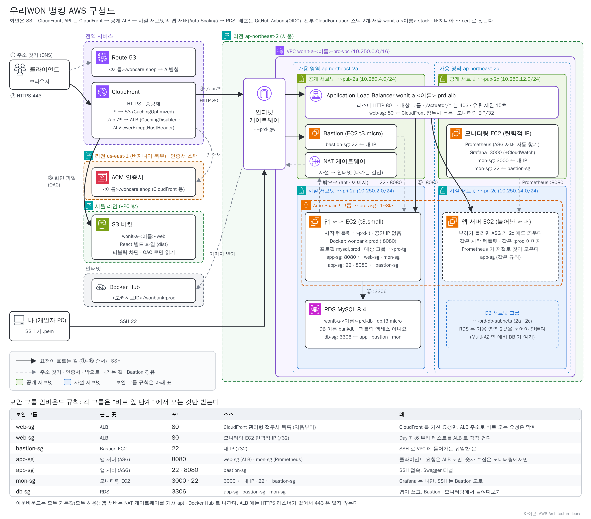

# Day 7. 부하 걸고, 서버가 저절로 늘어나는 것 보기

> 태그 · 시작 코드 `t10-monitoring` (오늘은 코드를 고치지 않습니다)<br>
> 앞 단계: [Day 5](day5-aws.md) → [Day 6](day6-cicd-monitoring.md) → **Day 7**

> 🆘 **늦었을 때**: 내 코드가 어긋났다면 `t10-monitoring` 으로 맞춥니다 (`load/transfers.js` 가 내 fork 에 있어야 합니다).
>
> ```bash
> git fetch origin --tags --force && git switch -c my-t10 t10-monitoring
> ```
>
> 스택(`wonit-a-<이름>-stack`)이 없다면 [Day 5](day5-aws.md) 7교시로 만듭니다. Prometheus · Grafana · k6 용 ALB 허용 규칙은 스택이 이미 만들어 둡니다.

## 🗺 오늘의 그림



오늘은 새로 만드는 것이 없습니다. 그림의 **공개 층 모니터링 EC2 에서 ALB 로 가는 길**(k6)로 부하를 걸고, **사설 층의 Auto Scaling 그룹**(2a · 2c)에 서버가 1 → 3대로 늘어나는 것을 지켜본 뒤 **스택을 지웁니다.** 늘어난 서버도 같은 시작 템플릿 · 같은 app-sg 라서 Prometheus 가 저절로 찾습니다. 모니터링 EC2 와 앱 서버에는 **Bastion 을 거쳐** 들어갑니다.

## 🎯 오늘 할 일

1. Grafana 에서 **네 가지 신호**(요청 수 · 응답 시간 · 오류 · 포화도)를 찾아 읽습니다.
2. **k6** 로 클라이언트 10 · 30 · 50명 부하를 걸고 **기록표**를 적습니다.
3. 스택이 단 **확장 규칙**을 읽고, 50명 부하로 서버가 1 → 2 → 3대로 **저절로** 늘어나는 것을 봅니다.
4. 늘려도 되는 것과 안 되는 것을 **확인표**로 가리고, 알림을 종이에 설계합니다.
5. 스택을 **순서대로 지웁니다.**

> 🚨 **가장 중요한 한 줄**: 16교시 🧹 정리를 **끝까지** 합니다. 시간이 모자라면 다른 것을 줄이고 정리는 줄이지 않습니다. 15교시 끝에서 **원하는 용량을 1 로 돌리는 것**도 잊지 않습니다 (줄어드는 것은 천천히 일어납니다).

## ⏱ 흐름

| 교시 | 카드 | 산출물 |
|---|---|---|
| 13 | 13-1 네 가지 신호 찾기 / 13-2 평소 모습 기록 | 평소 숫자 메모 |
| 14 | 14-1 k6 준비 / 14-2 10명 / 14-3 50명 | 클라이언트 수별 기록표 |
| 15 | 15-1 확장 규칙 읽기 / 15-2 부하로 서버 늘리기 / 15-3 확인표 / (선택) 15-4 풀 크기 실험 | 시간 순서 표, 확인표 |
| 16 | 16-1 알림 설계 / 16-2 구조도 / 16-3 스택 지우기 | 깨끗이 지운 AWS |

## 💰 요금 한 줄

부하 테스트 자체는 몇 센트입니다. **늘어난 서버를 오래 두는 것**이 비용입니다 (t3.small 은 시간당 몇 센트이니 3대를 밤새 두면 쌓입니다).

# 13교시. 상황판 읽기

## 🃏 카드 13-1. 네 가지 신호를 상황판에서 찾기

**한 줄로**: 패널이 아무리 많아도 지점이 건강한지는 **클라이언트 수 · 기다린 시간 · 실패 · 직원이 얼마나 바쁜가** 네 가지로 먼저 봅니다.

**따라 하기**
1. **브라우저** → 스택 출력 `GrafanaUrl` 에 로그인합니다 (`admin` / `Wooriwon1!`).
2. **Dashboards** → Day 6 에서 가져온 대시보드(19004)를 열고 위쪽 **Application** 이 `wonit` 인지 봅니다. 시간 범위 **Last 15 minutes**, 새로 고침 **30s 이상** (CloudWatch 패널은 조회할 때마다 요금이 붙습니다).
3. 아래 표대로 패널을 하나씩 찾습니다.

| 신호 | Prometheus 패널 (서버 안) | CloudWatch 패널 (ALB) |
|---|---|---|
| 요청 수 | HTTP 요청 수, 내 패널 `초당 이체 건수` | `RequestCount` |
| 응답 시간 | HTTP 응답 시간(평균 · 최대) | `TargetResponseTime` |
| 오류 | HTTP 5xx | `HTTPCode_Target_5XX_Count` |
| 포화도 | HikariCP 연결, JVM 메모리, CPU | `HealthyHostCount` (몇 대가 일하나) |

   

**✅ 되었으면**: 네 가지 신호마다 패널을 하나씩 손가락으로 짚을 수 있습니다.

**⚠️ 틀리기 쉬운 곳**
- 패널이 전부 `No data` → **Application** 이 `wonit` 인지, Explore 의 `up` 이 서버 수만큼 `1` 인지 봅니다.

<details><summary>📖 더 알아보기</summary>

- **평균이 아니라 p95**: 100명 중 90명 0.1초, 10명 5초면 평균은 0.59초로 괜찮아 보여도 10명은 5초를 기다렸습니다. p95 는 느린 쪽을 드러냅니다 (우리 앱은 p95 재료를 안 내보내서 **14교시 k6 결과**에서 읽습니다).
- 2xx 성공, 4xx(잔액 부족 등)는 **클라이언트** 잘못, 5xx 는 **서버** 잘못입니다. 5xx 그래프는 5xx 만 셉니다.

</details>

## 🃏 카드 13-2. 평소 모습을 숫자로 적어 두기

**한 줄로**: 리허설 전에 **아무도 없는 지점**의 모습을 적어 둡니다. 비교할 기준이 있어야 합니다.

**따라 하기**
1. **Grafana** → 요청 수 · 응답 시간(평균) · `HealthyHostCount` 의 지금 값을 메모합니다.
2. **브라우저** → `https://<이름>.woncare.shop` 에서 로그인해 입금으로 돈을 넣고, 이체 **5번** 성공, 잔액보다 큰 금액으로 **1번** 이체합니다.
3. **Grafana** → 어떤 패널이 움직였는지 봅니다. 1분에 이체 5건이면 `rate(…[1m])` 은 약 5 ÷ 60 ≈ 0.08 입니다.

**✅ 되었으면**: 내 패널이 올랐고, 잔액 부족은 4xx 줄에만 잡히며 5xx 는 0 입니다.

### ✍️ 해 보기 (15분)
2 · 3 을 하면서 "움직일 패널" 을 **먼저 예상**하고 맞았는지 표시합니다. 틀린 것은 한 줄로 이유를 적습니다.

### 🧩 체크
1. 잔액 부족 이체를 보냈더니 5xx 그래프는 0 이었습니다. 왜일까요?
2. 요청 100개 중 90개 0.1초, 10개 5초면 평균과 p95 는?
<details><summary>정답 보기</summary>

1. 잔액 부족은 **클라이언트의 잘못된 요청(409, 4xx)** 이라 5xx 에 안 들어갑니다.
2. 평균 **0.59초**, p95 는 **5초**쪽입니다.

</details>

# 14교시. 부하 걸기 (k6)

> 🏦 **은행에서는**: 부하 테스트를 **운영 서버에 함부로 걸지 않습니다.** 오늘은 내가 만든 실습 서버라서 괜찮습니다. 남의 서버에는 절대 걸지 않습니다.

## 🃏 카드 14-1. k6 준비: 문 확인 · 모니터링 EC2 들어가기

**한 줄로**: 리허설 인원(k6)은 모니터링 EC2 에서 출발합니다. ALB 입구(web-sg)에는 그 EC2 한 줄을 **스택이 이미 적어 두었으니** 확인만 합니다.

**따라 하기**
1. **EC2 → 보안 그룹 → `…-prd-web-sg` → 인바운드 규칙**: 80 에 CloudFront 접두사 목록 줄과 **모니터링 EC2 탄력적 IP/32** 줄(설명 `k6 load test from monitoring EC2`)이 있는지 봅니다.
2. **내 PC (Git Bash)** → `cd ~/.ssh` 후 스택 출력 `MonitoringSsh` 의 명령을 그대로 실행합니다 (Bastion 을 거쳐 모니터링 EC2 로 들어갑니다).
3. **모니터링 EC2** → 내 fork 를 받고 ALB 가 대답하는지 봅니다 (`<ALB DNS>` 는 출력 `AlbDnsName`).
   ```bash
   git clone https://github.com/<GitHub 아이디>/<저장소 이름>.git && cd <저장소 이름>
   head -3 load/transfers.js
   curl -s -o /dev/null -w "%{http_code}\n" http://<ALB DNS>/swagger-ui.html
   ```

**✅ 되었으면**: `head` 로 스크립트 첫 줄이 보이고, 숫자 `200` (또는 `302`)이 나옵니다.

**⚠️ 틀리기 쉬운 곳**
- `load/transfers.js` 가 없음 → Day 6 11-1 의 `git checkout t10-monitoring -- load` 를 안 하고 push 한 것입니다. 내 PC 에서 하고 push 한 뒤 `git pull` 합니다.
- `curl` 이 멈춤 → 1번의 규칙 IP 가 모니터링 EC2 의 탄력적 IP 인지 봅니다. 접속이 안 되면 내 IP 가 바뀐 것입니다 (Day 6 12-1).

<details><summary>📖 더 알아보기</summary>

- 도메인이 아니라 ALB 주소로 거는 이유: CloudFront 를 거치면 부하가 몰릴 때 막힐 수 있고 숫자에 CloudFront 가 섞입니다. ALB 로 직접 걸면 "ALB 와 서버" 만 잽니다.
- 보안 그룹 참조(mon-sg) 대신 IP 인 이유: 인터넷 경계형 ALB 에는 요청이 **공인 IP** 로 보여 "부서 이름" 이 통하지 않기 때문입니다.

</details>

## 🃏 카드 14-2. 10명으로 가볍게

**한 줄로**: 클라이언트 **10명**을 20초만 보내 길이 잘 이어졌는지 봅니다. k6 는 시작할 때 **스스로 클라이언트 두 명(A · B)을 가입**시키고 A 에 100만 원을 넣습니다.

**따라 하기**
1. **모니터링 EC2** → 내 fork 폴더에서 10명, 20초로 실행합니다.
   ```bash
   docker run --rm -i -e BASE_URL=http://<ALB DNS> -e PEAK_VUS=10 -e HOLD=20s grafana/k6 run - < load/transfers.js
   ```
2. 약 40초 뒤 나오는 요약에서 아래 줄을 찾습니다.

| 줄 | 읽는 법 |
|---|---|
| `✓` / `✗` (THRESHOLDS) | 합격선 통과 여부 |
| `http_req_duration` 의 `p(95)` | **응답 시간 p95** (ms). 오늘 가장 많이 보는 숫자 |
| `http_req_failed` | 실패한 요청 비율 (4xx · 5xx 모두) |
| `http_reqs` · `checks` | 요청 총 개수와 초당 요청 수 / 기대한 상태 코드(목록 200 · 이체 201)의 성공률 |

   

**✅ 되었으면**: 합격선이 모두 `✓`, `http_req_failed` 가 0% 근처입니다.

**⚠️ 틀리기 쉬운 곳**
- `가입 실패 …` · `로그인 실패 …` → `BASE_URL` 오타, 또는 ALB 입구가 안 열림(14-1). `checks` 가 100% 미만이면 앱 서버의 `docker logs wonbank` 로 원인을 봅니다.

<details><summary>📖 더 알아보기</summary>

- `/api/ai/*` 는 일부러 뺐습니다. 요청마다 외부 AI 요금이 나가기 때문입니다. 모든 이체가 **같은 계좌(A)** 에서 나가 비관적 락이 한 줄로 세웁니다 (결과 해석의 열쇠).
- `setup()` 은 시작 때 한 번 가입 · 로그인하고 토큰을 돌려 씁니다 (클라이언트마다 로그인하면 BCrypt 계산이 부하의 대부분이 됩니다). `stages` 는 15초 동안 0 → PEAK 명 → `HOLD` 유지 → 0 입니다.

</details>

## 🃏 카드 14-3. 50명으로 걸고 기록표 채우기

**한 줄로**: 인원을 50명으로 늘려 지점이 어디서부터 느려지는지 숫자로 남깁니다.

**따라 하기**
1. **Grafana** → 시간 범위 **Last 5 minutes**, 새로 고침 **30s** 로 두고 창을 옆에 띄웁니다.
2. **모니터링 EC2** → `PEAK_VUS` · `HOLD` 를 빼면 기본값(50명, 40초)입니다. 약 1분 동안 Grafana 를 봅니다.
   ```bash
   docker run --rm -i -e BASE_URL=http://<ALB DNS> grafana/k6 run - < load/transfers.js
   ```
   
3. 끝나면 기록표에 적고 30명(`PEAK_VUS=30`)도 해 봅니다.

| 클라이언트 수 | p95 (ms) | 초당 요청 | 실패율 |
|---|---|---|---|
| 10 · 30 · 50 | | | |

**✅ 되었으면**: 클라이언트가 늘수록 p95 가 올라가는 줄이 표에 보입니다.

**⚠️ 틀리기 쉬운 곳**
- `✗ p(95)<1000` → 느리다는 정상적인 결과일 수 있습니다. 숫자를 적고 15교시에서 이어 봅니다.

### ✍️ 해 보기 (15분)
클라이언트 수 **10 → 30 → 50** 으로 같은 명령을 세 번 실행해 표를 채웁니다 (`HOLD=20s` 면 빠릅니다). 클라이언트가 5배일 때 초당 요청도 5배인지 짝과 이야기합니다.

### 🧩 체크
1. `setup()` 에서 가입과 로그인을 한 번만 하는 이유는?
2. 부하 테스트에 AI 주소를 넣지 않는 이유는?
<details><summary>정답 보기</summary>

1. BCrypt 는 일부러 느린 계산이라 클라이언트마다 로그인하면 재려는 이체가 아니라 로그인이 부하의 대부분이 됩니다.
2. 요청마다 외부 AI 호출 요금이 나가고 무료 한도가 금방 바닥나기 때문입니다.

</details>

# 15교시. 서버가 저절로 늘어나는 것 보기

> 💡 **인사팀 비유**: Auto Scaling 그룹은 지점의 **인사팀**입니다. 클라이언트가 몰리면 새 직원을 부르고 한가해지면 천천히 돌려보냅니다 ("최소 1 · 원하는 1 · 최대 3"). 새 직원은 **업무 매뉴얼**(시작 템플릿)대로 Docker 설치부터 앱 실행까지 스스로 준비합니다.

## 🃏 카드 15-1. 스택이 단 확장 규칙(대상 추적 정책) 읽기

**한 줄로**: 인사팀에는 이미 "창구 직원 한 명이 1분에 받는 클라이언트가 **이 숫자**를 넘으면 충원하세요" 라는 규칙이 적혀 있습니다. 직접 달지 않고 **읽습니다.**

**따라 하기**
1. **EC2 → Auto Scaling 그룹 → `wonit-a-<이름>-prd-asg` → 자동 크기 조정** 탭을 엽니다.
2. 정책 한 줄을 눌러 아래 값을 확인합니다.

| 칸 | 값 |
|---|---|
| 정책 유형 | 대상 추적 크기 조정 |
| 지표 유형 | Application Load Balancer 요청 수/대상 (대상 그룹 `…-prd-tg`) |
| 대상 값 | `600` (스택 파라미터 `RequestsPerTargetPerMinute`) |

   
3. **대상 값의 단위**는 "**1분 동안, 서버 1대당**" 요청 수입니다.

| 대상 값 | 뜻 | 결과 |
|---|---|---|
| 10 | 1분에 10건 (초당 약 0.17건) | 몇 번만 눌러도 서버가 늘어남 |
| **600** | 1분에 600건 (**초당 10건**) | 권장 시작점 (기본값) |

4. 값을 바꾸고 싶으면 **CloudFormation → 스택 → `wonit-a-<이름>-stack` → 업데이트 → 현재 템플릿 사용 → 다음** → 파라미터에서 그 칸만 바꿉니다 (가려진 `****` 칸은 건드리지 않으면 그대로 유지됩니다) → 다음 → 다음 → **IAM 리소스를 만들 수 있음** 체크 → 제출.

**✅ 되었으면**: 정책이 한 줄 보이고 대상 값이 `600` 이며, 활동 탭은 아직 조용합니다.

**⚠️ 틀리기 쉬운 곳**
- 정책이 안 보임 → 스택이 아직 업데이트 중이거나 ASG 이름을 잘못 연 것입니다.
- 스택을 **업데이트하면 스택의 값(`DesiredCapacity`)으로 돌아갈 수 있습니다.** 콘솔에서 손으로 바꾼 용량은 업데이트 뒤 다시 확인합니다.

<details><summary>📖 더 알아보기</summary>

- 대상 추적은 온도 조절기와 같습니다. CPU 가 아니라 요청 수를 쓰는 것은 같은 계좌의 락 때문에 요청이 줄 서서 CPU 는 한가한데 응답이 느릴 수 있어서입니다.
- 1분 단위 값이 목표를 **연속 3분** 넘으면 늘립니다(대상 추적). 줄이기는 따로 둔 **빠른 축소 경보**(`…-prd-quiet-scale-in`)가 합니다: 1대당 분당 60 아래가 **3분** 이어지면 최소 대수로 한 번에 줄입니다. 대상 추적 자체의 축소는 15분이 걸려 수업에서는 껐습니다(`DisableScaleIn`).

</details>

## 🃏 카드 15-2. 50명 부하로 서버 늘리기

**한 줄로**: 인원 50명을 길게 세워 두고, 인사팀이 직원을 충원해 **새 창구가 저절로 열리는** 순서를 시간대별로 지켜봅니다.

**따라 하기**
1. 창 네 개: ① ASG **활동** 탭 ② 대상 그룹 **대상** 탭 ③ Grafana (30s) ④ 모니터링 EC2 터미널.
2. **모니터링 EC2** → 50명을 **6분 이상** 겁니다.
   ```bash
   docker run --rm -i -e BASE_URL=http://<ALB DNS> -e PEAK_VUS=50 -e HOLD=8m grafana/k6 run - < load/transfers.js
   ```
3. 아래 순서를 눈으로 따라가며 일어난 시각을 **내 칸에 적습니다.**

| 순서 | 일어나는 일 | 어디서 보나 | 내 시각 |
|---|---|---|---|
| ① | 서버 1대가 받는 분당 요청 수가 대상 값을 넘음 | Grafana `RequestCount` | |
| ② | CloudWatch 경보 `AlarmHigh` 가 **경보 상태** | CloudWatch → 경보 | |
| ③ | ASG 활동에 `Launching a new EC2 instance` (1 → 2) | ASG → 활동 탭 | |
| ④ | 새 서버가 켜지고 사용자 데이터대로 앱을 띄움 (약 3~4분) | EC2 → 인스턴스 | |
| ⑤ | 대상 그룹에 새 서버가 `initial` → **`healthy`** | 대상 그룹 → 대상 | |
| ⑥ | Explore 의 `up` 에 서버 줄이 **저절로** 늘어 `1` | Grafana → Explore | |
| ⑦ | 요청이 나뉘어 응답 시간이 내려가고 `HealthyHostCount` 가 오름 | Grafana | |
| ⑧ | 아직 대상 값을 넘으면 같은 순서로 2 → 3 | ASG → 활동 탭 | |

   
   
4. **Grafana → Explore** 에서 `up` 을 실행합니다. 주소를 적어 둔 곳이 없는데도 서버 줄이 3개가 됩니다.
   
5. 대시보드에서 `HealthyHostCount` 가 늘고 응답 시간이 내려가는 구간을 찾습니다.
   
6. k6 가 끝나고 **약 5분** 뒤 빠른 축소 경보가 울려 서버가 최소 대수로 줄어듭니다. 활동 탭에 `quiet-scale-in … changing the desired capacity from 3 to 1` 과 `Terminating EC2 instance` 줄이 생깁니다.
   

**✅ 되었으면**: 서버가 1 → 2 → 3대로 늘었고, 부하를 끈 뒤 원하는 용량을 1 로 돌려 한 대만 남았습니다.

**⚠️ 틀리기 쉬운 곳**
- 새 서버가 `unhealthy` → 유예 기간(300초) 전에는 ASG 가 바꾸지 않습니다. 기다립니다. 계속이면 앱 서버 안(Bastion 경유 `AppSsh`)에서 `docker logs wonbank` 를 봅니다.
- 용량을 1 로 돌리는 것을 잊음 → 서버 3대가 계속 켜져 요금이 나옵니다.

<details><summary>📖 더 알아보기</summary>

- 몇 분 걸리는 이유: ① CloudWatch 가 1분 단위 값을 연속으로 확인(경보) ② 새 서버가 Docker 를 설치하고 NAT 로 이미지를 받아 앱을 시작(3~4분) ③ 대상 그룹이 상태 검사(15초 간격, 정상 2번)로 확인. 그래서 **갑자기 몰리는 클라이언트**에는 미리 용량을 늘려 둡니다.
- 새 서버가 Prometheus 에 저절로 나타나는 것은 Prometheus 가 30초마다 EC2 에 "내 ASG 의 서버" 를 묻기 때문입니다.

</details>

## 🃏 카드 15-3. 늘려도 되는 것 확인하기

**한 줄로**: 창구가 3개로 늘었을 때 **클라이언트가 어느 창구로 가도 똑같이 처리되는지** 확인표로 가립니다.

**따라 하기**
1. **모니터링 EC2** → 토큰 하나를 받습니다.
   ```bash
   sudo apt-get install -y jq
   BASE=http://<ALB DNS>
   TOKEN=$(curl -s -X POST $BASE/api/auth/login -H "Content-Type: application/json" -d '{"loginId":"<아이디>","password":"<암호>"}' | jq -r .accessToken)
   ```
2. 서버가 2대 이상인 동안 토큰 **하나**로 여러 번 부릅니다.
   ```bash
   for i in 1 2 3 4 5 6; do curl -s -o /dev/null -w "%{http_code}\n" $BASE/api/accounts -H "Authorization: Bearer $TOKEN"; done
   ```
3. 확인표를 채웁니다.

| # | 확인 | 결과 (O / X) | 왜 이렇게 되었나 |
|---|---|---|---|
| ① | 토큰 하나로 서버 모두 200 | | |
| ② | k6 가 끝난 뒤 받는 계좌 잔액이 정확히 맞음 | | |
| ③ | AI 대화가 서버가 바뀌어도 이어짐 (예상: X) | | |
| ④ | RAG 벡터는 서버마다 따로 | | |

**✅ 되었으면**: ①은 6줄 모두 `200` 입니다. 나머지는 📖 에서 이유를 확인합니다.

**⚠️ 틀리기 쉬운 곳**
- `401` → 토큰이 비었거나 만료(30분)입니다. 로그인 줄을 다시 칩니다. ③ · ④ 는 직접 해 보지 않고 📖 로 답합니다.

<details><summary>📖 더 알아보기</summary>

- ① 토큰은 **클라이언트가 들고** 있고 모든 서버가 같은 `JwtSecret` 으로 검사합니다. 세션(서버 메모리)이었다면 서버 B 가 몰라서 다시 로그인하라고 했을 것입니다.
- ② B 의 잔액이 `10원 × 이체 201 개수` 와 같으면 돈이 어긋나지 않은 것입니다. 락이 **서버가 아니라 DB 에** 있어서 서버가 몇 대든 한 줄로 섭니다.
- ③ · ④ AI 대화 기억과 RAG 벡터는 **서버 메모리**라 서버마다 따로입니다. 💡 서버를 늘리고 줄이려면 기억을 자기 안에 두지 말고 DB 같은 **공용 장소**에 맡겨야 합니다.

</details>

## 🃏 (선택) 카드 15-4. 커넥션 풀 실험: 병목은 어디에 보이나

<details><summary>펼치기: DB 연결 개수(풀)를 10 → 2 로 줄여 DB 창구를 좁혀 봅니다</summary>

1. 스택 업데이트 (15-1 의 4번 방법)로 `DbPoolSize` = `2` → 완료되면 **EC2 → Auto Scaling 그룹 → 인스턴스 새로 고침 → 인스턴스 새로 고침 시작** (스택은 시작 템플릿 새 버전만 만들고 서버를 바꾸지는 않습니다).
   
2. 50명 부하를 걸고 Grafana HikariCP 패널에서 `active` 가 `max`(2)에 붙고 `pending` 이 오르는지 봅니다.
   
3. 끝나면 같은 방법으로 `DbPoolSize` = `10` 으로 되돌리고 서버를 다시 갈아 끼웁니다.

참고(내 PC 값): 50명에서 풀 10 은 p95 약 92ms, 풀 2 는 약 140ms. 같은 계좌 락 때문에 차이가 작았고, 서버가 3대면 DB 연결이 3 × 풀 크기가 되니 풀은 클수록 좋은 것이 아닙니다.

</details>

### ✍️ 해 보기 (15분)
15-2 표의 "내 시각" 을 채워 ②부터 ⑥까지 **총 몇 분** 걸렸는지 계산하고, 한 줄 결론을 적습니다: "서버가 3대로 늘었더니 응답 시간이 ______ 했다. 왜냐하면 ______." 원하는 용량을 1 로 돌렸는지 활동 탭에서 확인합니다.

### 🧩 체크
1. 서버가 늘어난 뒤 Prometheus 설정을 고치지 않았는데 Targets 에 나타난 이유는?
2. 서버를 3대로 늘렸는데 이체 속도가 3배가 되지 않았습니다. 가능한 이유 두 가지는?
<details><summary>정답 보기</summary>

1. Prometheus 가 30초마다 EC2 API 로 "내 ASG 꼬리표가 붙은 서버" 를 찾기 때문입니다.
2. ① 모든 이체가 같은 계좌라 병목이 서버가 아니라 DB 락에 있습니다. ② 서버가 늘어난 만큼 DB 연결도 늘어(3 × 풀 크기) DB 부담이 커집니다.

</details>

# 16교시. 알림 · 구조도 · 정리

## 🃏 카드 16-1. 알림 설계(종이)

**한 줄로**: 관리실 계기판에 불이 들어와도 **아무도 안 보고 있으면** 소용없으니 "무엇을 · 언제 · 누구에게" 를 먼저 정합니다.

**따라 하기**
1. 아래 표에서 규칙 하나를 골라 "조건 · 지속 · 받는 사람 · 받으면 먼저 볼 곳" 을 한 줄로 적습니다.

| 무엇을 | 조건 | 지속 |
|---|---|---|
| 앱 다운 | `up{job="wonbank"} == 0` | 1~2분 |
| 정상 서버 수 부족 | `HealthyHostCount` < 1 | 1~2분 |
| 서버 오류(5xx) 비율 | 5xx ÷ 전체 > 1% | 5분 |
| DB 커넥션 대기 | `hikaricp_connections_pending > 0` | 5분 |

2. **(선택)** **Grafana → Alerting → Alert rules → New alert rule**: 이름 `앱 다운`, Prometheus, 쿼리 `up{job="wonbank"}`, 조건 `IS BELOW 1`, 평가 1분 · 지속 1분 → 저장. 상태가 **Normal → Pending → Firing** 으로 바뀌는 것까지만 봅니다.
   

**✅ 되었으면**: 알림 규칙 한 줄이 적혀 있습니다.

<details><summary>📖 더 알아보기</summary>

- **지속 시간**이 없으면 잠깐 튄 값에도 알림이 와 사람이 무시합니다(알림 피로). 🏦 은행에서는 알림에 **등급**을 두고 모든 알림에 대응 문서(런북)를 짝지웁니다.

</details>

## 🃏 카드 16-2. 구조도 그리기

**한 줄로**: 오늘까지 만든 것을 빈 종이에 **직접** 그려 봅니다.

**따라 하기**
1. 위 🗺 그림을 가리고 이 순서로 그립니다: 브라우저 → Route 53 → CloudFront(화면은 S3, `/api` 는 ALB) → ALB → 대상 그룹 → 앱 서버(ASG, 사설 서브넷) → RDS.
2. 옆에 모니터링 EC2(Prometheus · Grafana), Bastion, GitHub Actions(화면은 S3, 서버는 `:prod` → ASG)를 붙입니다.

**✅ 되었으면**: 문이 CloudFront 와 Bastion 두 곳뿐인 그림이 한 장 있습니다.

## 🃏 카드 16-3. 스택 지우기 (🧹 정리 순서표)

**한 줄로**: 스택 삭제가 대부분을 지워 주지만, **S3 를 먼저 비우고**, 스택 밖에 만든 것(인증서 스택 · 호스팅 영역 · 키 페어)은 **내가 지웁니다.**

> 🚨 **여기를 건너뛰면 요금이 계속 나옵니다.** 특히 ALB · EC2 3대 · NAT 게이트웨이 · RDS · 탄력적 IP · CloudFront.

**따라 하기**
1. 아래 표를 위에서 아래로 합니다.

| 순서 | 할 일 | 메모 |
|---|---|---|
| 1 | (선택) **RDS → 데이터베이스 → `…-prd-db` → 작업 → 스냅샷 생성** | 스택은 DB 를 스냅샷 없이 지웁니다. 수동 스냅샷은 **남아서 요금**이 나가니 확인 뒤 지웁니다 |
| 2 | **S3 버킷 비우기**: **S3 → `wonit-a-<이름>-web` → 비우기** (또는 `aws s3 rm s3://wonit-a-<이름>-web --recursive`) | 비우지 않으면 스택 삭제가 실패합니다 |
| 3 | **CloudFormation → 스택 → `wonit-a-<이름>-stack` → 삭제** | 15~25분 (CloudFront 가 오래 걸림). VPC · NAT · 서버 3대 · ALB · RDS · 탄력적 IP · 역할이 같이 지워짐 |
| 4 | **버지니아로 리전 변경** → 스택 `wonit-a-<이름>-cert` 삭제 | 3번이 `DELETE_COMPLETE` 가 된 뒤에만 지워집니다 |
| 5 | **Route 53 → 호스팅 영역** 에서 NS · SOA 외 레코드가 없는지 보고 → 호스팅 영역 삭제 | 남은 레코드가 있으면 먼저 지웁니다 |
| 6 | **EC2 → 키 페어 → `wonit-a-<이름>-key` 삭제** + 내 PC 의 `.pem` 삭제 | 서울 |
| 7 | **리소스 그룹 및 태그 편집기 → 태그 편집기** 에서 리전 **서울 · 버지니아**, 태그 `Owner` = `<이름>` 검색 | **0건**이어야 합니다 |
| 8 | GitHub 변수에서 AWS 값 지우기(선택), Docker Hub 토큰 폐기, 발급 사이트의 내 하위 도메인 회수 | 스택 밖 |

   
   
2. 마지막으로 태그 편집기 검색 결과가 0건인지 확인합니다.
   

**✅ 되었으면**: 서울 · 버지니아 두 스택이 `DELETE_COMPLETE`, 호스팅 영역과 키 페어가 없고, 태그 검색이 **0건**입니다.

**⚠️ 틀리기 쉬운 곳**
- 스택 삭제가 `DELETE_FAILED` → 이벤트 탭의 실패 줄을 봅니다. 대개 S3 가 비워지지 않았습니다 (`BucketNotEmpty`). 비운 뒤 다시 삭제합니다.
- 인증서 스택 삭제 실패 → 서울 스택이 아직 지워지는 중입니다 (CloudFront 가 인증서를 씁니다). Route 53 영역 삭제가 `not empty` → NS · SOA 외 레코드를 먼저 지웁니다.

<details><summary>📖 더 알아보기</summary>

- 순서의 원칙: 쓰는 쪽(스택)을 먼저, 쓰이는 쪽(인증서 · 영역)을 나중에. 서버를 만들고 없애는 ASG 가 스택 안에 있어 스택을 지우면 서버도 함께 종료됩니다.
- 🚨 Route 53 레코드가 지운 CloudFront 주소를 가리킨 채 남으면 남이 그 주소를 가져가 내 하위 도메인으로 쓸 위험이 있습니다.

</details>

### ✍️ 해 보기 (15분)
알림 규칙 하나를 만들어 **Normal → Pending → Firing** 을 봅니다 (선택). 시간이 없으면 설계 표에서 하나를 골라 한 줄로 적고 곧바로 🧹 정리를 시작합니다.

### 🧩 체크
1. 스택을 지우기 전에 S3 를 먼저 비우는 이유는?
2. 인증서 스택을 서울 스택보다 나중에 지우는 이유는?
<details><summary>정답 보기</summary>

1. 파일이 든 버킷은 삭제되지 않아 스택 삭제가 `DELETE_FAILED` 가 되기 때문입니다.
2. CloudFront 가 사용 중인 인증서는 삭제되지 않습니다. 쓰는 쪽을 먼저 지워야 쓰이는 쪽을 지울 수 있습니다.

</details>

# 🧹 오늘 정리

- [ ] 네 가지 신호를 Prometheus 패널과 CloudWatch 패널에서 찾아 설명할 수 있다
- [ ] k6 로 10 · 30 · 50명 부하를 걸고 `p(95)` · `http_reqs` · `http_req_failed` 를 읽어 기록표를 채웠다
- [ ] 서버가 1 → 2 → 3대로 늘어나는 순서를 시간 순서 표에 적었고, **원하는 용량을 1 로 돌렸다**
- [ ] 확인표로 "늘려도 되는 것 / 깨지는 것" 을 구분할 수 있고, 알림을 설계했으며, 구조도를 그릴 수 있다
- [ ] **🧹 정리 순서표 1~8 을 끝냈고 `Owner=<이름>` 태그 검색 결과가 0건이다**

# 🎤 면접에서는 이렇게 묻습니다

> 답변은 **"한 문장 정의 → 우리 프로젝트에서는 → 왜"** 순서로 30초 안에 말해 봅니다.

**Q1. Auto Scaling 은 어떻게 서버를 늘리나요?**
<details><summary>모범 답안</summary>

> 정해 둔 지표가 기준을 넘으면 CloudWatch 경보가 울리고, Auto Scaling 그룹이 시작 템플릿으로 새 서버를 만들어 대상 그룹에 넣습니다. 저희는 서버 한 대당 분당 요청 수를 기준으로 하는 대상 추적 정책(스택이 만든 것)을 썼고, 50명 부하에서 1대가 2 · 3대로 늘었습니다. 새 서버는 상태 검사를 통과한 뒤에야 클라이언트를 받고 줄이는 것은 천천히 일어나서, 갑자기 몰리는 클라이언트에는 미리 용량을 늘려 두는 것이 낫습니다.

</details>

**Q2. 서버를 여러 대로 늘려도 되는 조건은 무엇인가요?**
<details><summary>모범 답안</summary>

> 서버가 요청 사이에 기억할 정보를 자기 메모리에 두지 않는 무상태여야 합니다. 저희는 로그인을 JWT 로 해서 서버가 저장하지 않고, 이체 락은 DB 의 비관적 락에 두었습니다. 그래서 토큰 하나로 모든 서버가 200 이었습니다. AI 대화 기억처럼 서버 메모리에 둔 것이나 세션, `synchronized` 는 서버마다 따로라서 늘리면 깨지거나 끊깁니다.

</details>

**Q3. 부하 테스트를 위해 ALB 를 열어 둔 것은 어떻게 관리했나요?**
<details><summary>모범 답안</summary>

> ALB 는 평소 CloudFront 접두사 목록에서 온 80 만 받습니다. k6 를 모니터링 EC2 에서 직접 걸어야 해서 그 EC2 의 탄력적 IP/32 한 줄만 설명을 달아 스택에 함께 정의했습니다. 스택을 지우면 그 규칙도 같이 사라지므로 열어 둔 채 잊을 일이 없습니다. 임시로 연 문은 이유를 적어 두고 끝나면 닫는 것이 원칙입니다.

</details>
