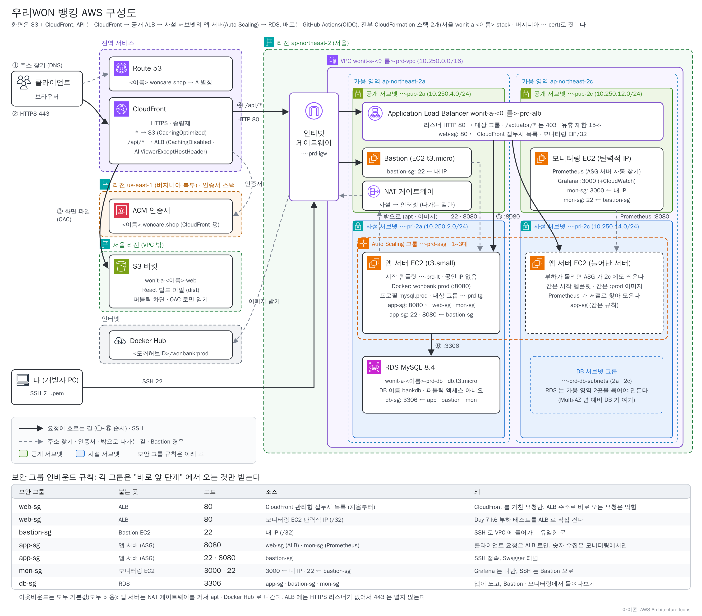

# 화면 배포 참고: S3 · CloudFront 구조와 손으로 다시 올리기

> 우리 은행 화면(React)은 **S3** 에 올라가고 **CloudFront** 가 `https://<이름>.woncare.shop` 으로 나눠 줍니다. 같은 주소의 `/api/*` 는 서버(ALB)로 갑니다.<br>
> 💡 수업에서는 **스택(`infra/wonit-a-aws.yaml`)이 이 구조를 모두 만들고, 올리는 일은 GitHub Actions(`ci/frontend.yml`)가 합니다** ([Day 6](day6-cicd-monitoring.md)). 이 문서는 ① 구조가 왜 이런지 ② 스택의 어느 부분이 만드는지 ③ Actions 없이 손으로 다시 올리는 법을 모아 둔 참고 자료입니다.



| 하는 일 | 누가 |
|---|---|
| 주소창의 자물쇠(HTTPS) | CloudFront + ACM 인증서(버지니아) |
| 화면 파일(`/` · `/assets/…`) | CloudFront → **S3** |
| `/api/…` 요청 | CloudFront → **ALB** → 앱 서버 |
| `<이름>.woncare.shop` 을 CloudFront 로 연결 | Route 53 **A 별칭 레코드** |

> 💡 **S3 = 문 잠긴 창고, CloudFront = 안내 데스크.** 클라이언트는 창고에 직접 못 들어가고, 안내 데스크가 서류를 꺼내다 줍니다. 서류는 **복사해 두었다가**(캐시) 바로 주고, 업무(`/api`)는 본점(ALB)으로 넘깁니다.

# 1. 개념

## 화면은 "파일" 이라 서버가 필요 없습니다

React 를 빌드하면 **HTML · JS · CSS 파일**이 나옵니다(`frontend/dist/`). 받아 가기만 하는 파일이라 서버를 돌릴 필요가 없습니다. 서버(EC2)는 `/api` 계산만 합니다.

## 화면이 API 를 부르는 주소: `VITE_API_BASE=/api`

화면 코드는 그대로 두고 **빌드할 때 환경변수 하나**로 정합니다. Actions 는 `frontend.yml` 의 `env: VITE_API_BASE: /api` 로, 내 PC 는 `VITE_API_BASE=/api npm run build` 로 넣습니다.

- `/api` 이면 **지금 열린 주소의 `/api`** 로 갑니다. 그래서 화면과 API 가 **같은 주소**입니다. 다만 서버에는 "다른 주소에서 온 요청" 으로 보이므로 `WebConfig` 의 `allowedOrigins` 에 `https://<이름>.woncare.shop` 이 있어야 `POST` 가 통과합니다.
- 이 값은 `npm run build` 때 **JS 안에 굳어서 들어갑니다.** 값 없이 빌드하면 기본값 `http://localhost:8080/api` 가 들어가 배포한 화면이 API 를 못 부릅니다.

## 길 나누기: 원본 2개, 동작 2개, 캐시 정책 2개

| | 기본 동작 `*` | `/api/*` 동작 |
|---|---|---|
| 원본 | **S3 버킷** (OAC) | **ALB** (DNS 이름, HTTP 80) |
| 허용 메서드 | GET, HEAD | GET · HEAD · OPTIONS · PUT · POST · PATCH · DELETE |
| 캐시 정책 | **CachingOptimized** (복사해 둔다) | **CachingDisabled** (복사하지 않는다) |
| 원본 요청 정책 | 없음 | **AllViewerExceptHostHeader** (헤더를 서버까지 전달) |

경로가 더 구체적인 동작이 먼저 적용됩니다. 화면은 모든 클라이언트에게 같은 내용이라 복사해도 되지만, `/api` 응답은 **사람마다 다릅니다**(내 계좌). 복사하면 **다른 사람에게 내 응답이 나가고**, `Authorization` 헤더가 서버로 안 가면 모두 401 입니다.

## OAC · 버킷 정책 · 인증서 · A 별칭

- **OAC + 버킷 정책**: S3 는 퍼블릭 차단을 켠 그대로 두고, CloudFront 가 서명해서 꺼내 갑니다. 버킷 정책은 "`cloudfront.amazonaws.com` 의 `s3:GetObject` 를, 이 버킷에서, **내 배포(`AWS:SourceArn`)에서 온 것만**" 허락합니다.
- **버지니아 인증서**: CloudFront 는 전역 서비스라 기준 리전 `us-east-1` 의 인증서만 읽습니다. (ALB 에 HTTPS 를 붙일 때는 반대로 ALB 와 같은 서울 인증서.)
- **A 별칭**: `<이름>.woncare.shop` 은 영역의 꼭대기 이름이라 CNAME 을 둘 수 없고, A + 별칭은 둘 수 있으며 CloudFront 의 IP 가 바뀌어도 따라갑니다.

# 2. 스택에서는 어디에 있나

`infra/wonit-a-aws.yaml` 의 `# 09. 화면` 구역이 위 구조 전부입니다 (줄여 옮긴 발췌, 실제 파일은 들여쓰기가 더 깊습니다).

```yaml
WebBucket:           BucketName: wonit-a-${YourName}-web      # PublicAccessBlockConfiguration 4개 모두 true
WebOAC:              SigningBehavior: always, SigningProtocol: sigv4   # CloudFront 가 S3 에 서명
WebDistribution:
  Aliases: [!Ref DomainName]                  # 대체 도메인
  DefaultRootObject: index.html
  ViewerCertificate: { AcmCertificateArn: !Ref CertificateArn }       # 버지니아 인증서
  Origins: s3-web (OAC)  ·  alb-api (HTTP 80)
  DefaultCacheBehavior: { TargetOriginId: s3-web, CachePolicyId: 658327ea-… }   # CachingOptimized
  CacheBehaviors:
    - PathPattern: '/api/*'
      TargetOriginId: alb-api
      CachePolicyId: 4135ea2d-…               # CachingDisabled
      OriginRequestPolicyId: b689b0a8-…       # AllViewerExceptHostHeader
WebBucketPolicy:     Condition: AWS:SourceArn = 이 배포            # 내 배포만 읽기
SiteAliasRecord:     Type: A, AliasTarget: !GetAtt WebDistribution.DomainName
```

# 3. 손으로 다시 올리기 (Actions 없이)

**도메인은 다시 연결하지 않습니다.** Route 53 의 A 별칭 → CloudFront 배포 → S3 버킷으로 이미 이어져 있어서 버킷 안의 파일만 바뀝니다. 할 일은 세 가지입니다 (`frontend.yml` 이 하는 일과 같습니다).

| 순서 | 할 일 | 왜 |
|---|---|---|
| ① | 다시 빌드 (`VITE_API_BASE=/api`) | 고친 코드로 `dist/` 를 새로 만든다 |
| ② | S3 에 덮어 올리기 (옛 파일 지우기 포함) | 창고 안의 파일을 새것으로 바꾼다 |
| ③ | CloudFront 무효화 `/*` | 안내 데스크가 복사해 둔 옛 파일을 버린다 |

**① 다시 빌드 (내 PC (Git Bash))**

```bash
cd frontend
npm ci
VITE_API_BASE=/api npm run build    # PowerShell: $env:VITE_API_BASE="/api"; npm run build
grep -c 'localhost:8080' dist/assets/*.js      # 0 이어야 한다 (개발용 주소가 안 들어갔다)
```

`dist/` 안에 `index.html` · `favicon.svg` · `icons.svg` · `assets/` 가 있어야 합니다. `npm ci` 는 `package-lock.json` 의 버전 그대로 설치합니다.

**② S3 에 올리기**

- **콘솔**: **S3 → `wonit-a-<이름>-web` → 객체** 에서 옛 `assets/` 를 **삭제**하고, **업로드** 에 `dist/` **안의 것들**(`index.html` · `favicon.svg` · `icons.svg` · `assets/`)을 끌어다 놓습니다. 같은 이름의 `index.html` 은 덮어씁니다.
- **CLI** (AWS CLI 가 설정된 PC): `aws s3 sync frontend/dist s3://wonit-a-<이름>-web --delete` — `--delete` 는 `dist/` 에 없는 옛 파일을 버킷에서 지웁니다.

**③ 무효화**

- **콘솔**: **CloudFront → 내 배포 → 무효화 → 무효화 생성** → 객체 경로 `/*` → 상태가 **완료**(보통 1~2분)가 되면 사이트에서 `Ctrl+Shift+R`.
- **CLI**: `aws cloudfront create-invalidation --distribution-id <배포 ID> --paths '/*'` (배포 ID 는 스택 출력 `CloudFrontDistributionId`)

**확인**: `curl -sI https://<이름>.woncare.shop/ | grep -i x-cache` 가 무효화 직후 한 번은 `Miss`, 다시 하면 `Hit` 입니다 (`Hit from cloudfront` = 복사본으로 바로 줌).

> 💡 **왜 ③ 이 필요한가요?** CloudFront 는 받은 파일을 기본 **24시간** 복사해 두고 S3 에 다시 묻지 않습니다. JS · CSS 는 이름에 해시가 붙어 내용이 바뀌면 이름도 바뀌지만 **`index.html`** 은 이름이 늘 같아 옛것이 계속 나갑니다. 무효화 경로는 한 달 1,000개까지 무료이고 `/*` 는 1개로 셉니다.

> 💡 **Day 6 부터는 이 세 가지를 GitHub Actions 가 대신 합니다.** `frontend/` 를 고쳐 `main` 에 push 하면 빌드 → `s3 sync --delete` → `create-invalidation` 이 차례로 돕니다 (변수 `WEB_BUCKET` · `CF_DISTRIBUTION_ID` · `AWS_DEPLOY_ROLE_ARN`).

# 4. 틀리기 쉬운 곳

| # | 틀린 것 | 증상 | 고치는 법 |
|---|---|---|---|
| 1 | `dist` **폴더째** 업로드 | 화면 주소 **403** | S3 맨 위에 `index.html` 이 오게 다시 올리고 무효화 |
| 2 | `VITE_API_BASE=/api` 없이 빌드 | 로그인 실패, F12 에 `localhost:8080` | 값을 넣어 다시 빌드 → 올리고 무효화 |
| 3 | 올렸는데 옛 화면 | 고친 곳이 안 보임 | **무효화 `/*`**, 그래도면 `Ctrl+Shift+R` |
| 4 | CORS 주소 끝에 `/` 또는 도메인 누락 | `POST` 가 `403 Invalid CORS request` | `WebConfig` 의 `allowedOrigins` 에 `https://<이름>.woncare.shop` (끝 `/` 없이) → 다시 push |
| 5 | `/api/*` 가 **502** (ALB 는 정상) | 대상 그룹에 healthy 대상이 없다 | **EC2 → 대상 그룹 → 대상** 탭, 상태 검사 `/actuator/health` 확인 |
| 6 | 스택 삭제가 `DELETE_FAILED` | `BucketNotEmpty` | **S3 버킷 비우기** 뒤 다시 삭제 (Day 7 16-3) |

# 🎤 면접에서는 이렇게 묻습니다

<details><summary>Q1. 프론트엔드를 서버(EC2)가 아니라 S3 + CloudFront 로 배포하는 이유는?</summary>

> 빌드된 화면은 계산이 필요 없는 정적 파일이라 파일 저장소와 CDN 으로 나누어 주면 됩니다. 저희는 S3 를 퍼블릭 차단한 채 CloudFront 의 OAC 로만 읽게 했고, CloudFront 가 가까운 곳에서 복사본을 주어 빠르며, 서버는 `/api` 계산에만 집중합니다. 화면 트래픽이 늘어도 서버를 늘릴 필요가 없습니다.
</details>

<details><summary>Q2. 한 도메인에서 화면과 API 를 어떻게 나눴나요?</summary>

> CloudFront 의 동작으로 경로별 원본을 나눴습니다. 기본 동작은 S3 에 CachingOptimized, `/api/*` 는 ALB 에 CachingDisabled 와 AllViewerExceptHostHeader 를 썼습니다. 같은 도메인이라 브라우저 CORS 문제가 없고, API 응답은 캐시하지 않아 사용자별 응답이 섞이지 않으며, Authorization 헤더가 서버까지 전달됩니다.
</details>
